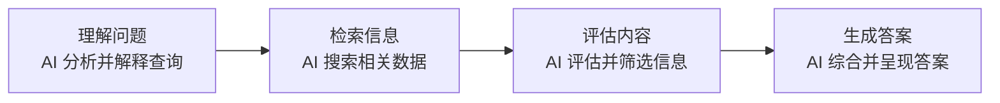

# SEO 与 GEO 的核心区别
| 对比维度 | 传统SEO | GEO优化 |
|---|---|---|
| 核心战场 | 搜索结果页 | AI的回答生成过程 |
| 优化对象 | 网站链接 | 内容资产 |
| 核心目标 | 提升排名，吸引点击 | 成为答案，建立信任 |
| 客户路径 | 搜索 → 浏览列表 → 点击链接 | 提问 → 直接阅读答案 |
| 算法偏好 | 页面等级、链接、点击量 | E-E-A-T-S、逻辑性、可验证性 |
| 关键词策略 | 侧重名词和短语 | 侧重问题句 |
| 流量性质 | 导航型流量（引导客户去别处） | 答案型流量（在当前满足需求） |
| 终极比喻 | 让客户“点进来” | 让AI“说出来” |

---

# E-E-A-T-S 谷歌用来评估内容质量的五个标准
- 经验 Experience
- 专业性 Expertise
- 权威性 Authoritativeness
- 可信赖性 Trustworthiness
- 结构化 Structure

---

# AI 处理一个问题的工作流程

---

## 理解问题过程
利用自然语言能力（NLP）能力，去理解问题到底是什么意思。
- 识别核心意图。是了解一个概念、学习一个方法、寻求一个推荐，还是比较两种事务的优劣。

- 拆解问题要素。AI 会把问题中的关键词、限定词、情感色彩等元素拆开。

> GEO 策略：内容标题和结构，必须清晰地对应客户的核心意图。例如使用“如何...”“为什么...”“...是什么”这样的问句作为标题。

---

## 检索信息-知识库来源
- 内部训练数据。相对静态。
- 外部实时信息。

> GEO 策略：内容必须发布在 AI 可以公开访问和抓取的平台。

---

## 评估内容模型
根据 E-E-A-T-S 模型。

---

## 生成答案
筛选出高分内容进行重组、提炼、总结和润色，最终生成一段通顺、连贯、满足客户需求的自然语言答案。

> GEO 策略：内容要模块化，即每一段话、每一个小标题下的内容，都应该是一个逻辑自洽、可被独立引用的“答案单元”。目标是称为被标注的引用来源，占据品牌曝光的黄金位置。

---

## 为什么要做 GEO
传统广告驱动的是一个“流量转化漏斗”。
客户从看到广告，到点击，浏览，咨询，成交，转化率层层递减。

GEO 构建的是一个“信任引力磁场”。
吸引来的是带着明确问题、寻求解决方案的“求知者”。
> 这个说法可能不太准确，与 SEO 目的是一样的。更多的是，解决路径的变化。

---

## 什么样类型的企业适合做 GEO

黄金赛道：一个行业的客户在做购买决策前，需要经理“研究——比较——寻求解决方案——建立信任”的过程。

> GEO 的目标是成为 AI 的首选信源。

1. 高客单价与高风险决策服务。
    - 决策成本高，信心不对称严重。
    - 客户的核心诉求是确定性和安全感。

2. B2B 企业服务与复杂问题解决方案提供。
    - 决策链条长。
    - 客户追求降低风险。

3. 强依赖本地化信任的服务。
    - “附近”是关键搜索触发词，消费半径小，线上评价和本地案例是建立信任的核心。
    - 客户的行为正在发生根本性改变。利用 AI 来筛选对比。

4. 个人品牌驱动的专家型服务
    - 影响力是核心资产。
    - 受众是一群主动的求知者，购买的不仅是服务，更是思想和观点。
    - 某个领域的意见领袖和思想源头。

> 一个跨行业的通用规则：从提供“功能”向提供“解决方案”转变。

---

传统思维：描述功能。
GEO 思维：提供场景化的解决方案。
GEO 战场：内容回答如何解决一个具体问题。

GEO 核心竞争力：对自己业务的<code>价值洞察力</code>和<code>结构化思考</code>的能力。

用相对较低的成本，去定义一个领域的“AI 标准答案”。

---