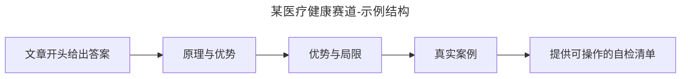
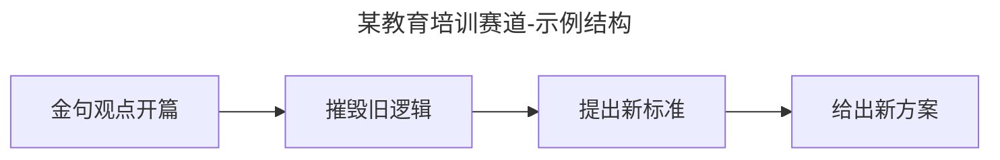

# 让 AI 在三秒内“读懂”你的核心思想，赢得 AI 调度最优推荐的两种模式

## 问题-答案模式
其本质将内容从一篇陈述重述为一个答案。

使用方法：
1. 用一个清晰、具体的客户问题作为标题。
（问题必须是真实的客户问题。）

2. 在文章的第一段，直接给出核心、精炼的答案。

3. 后续答案提供系统性的支撑。
（用“为什么这么说”“具体该怎么做”“有哪些案例”“需要注意什么”等小标题，来构建论证体系。）

---

## 定义-解释模式
称为一个新概念、一个行业术语的定义者，抢占 AI 知识库中“第一解释权”

使用方法：
1. 用“什么是 XX”或一个能引出新术语的问题作为标题
2. 在正文中，给出一个清晰、简洁、易于理解的定义
3. 用一个生动的比喻来降低客户的认知门槛
4. 用一个具体的案例来展示这个术语的实际应用

---

# 如何构建思想领导力的基石？

- [金句 - 论证模式](#golden-quote-argument)
- [框架 - 工具模式](#framework-tool)

## 金句 - 论证模式

- 战略定位：**思想的“破冰船”**。
- 核心逻辑：通过反常识的金句，
瞬间击穿客户的认知壁垒，
在其心中建立一个不可磨灭的思想阵地。

### 实战工作流拆解

1. **金句提炼**。从核心思想中，提炼出“病毒性”的金句。
    - 公式一：否定常识 + 重建逻辑。“A 不是 B，而是 C。”
    - 公式二：极端断言 + 制造悬念。“99% 的 XX，都是错的。”
    - 公式三：矛盾组合 + 引发好奇。“A，却导致了 B。”

2. **论证**。构建一个无懈可击的论证链条。
    - 结构：“总-分-总” 或 “第一，第二，第三” 
    - 原则：每一个分论点，都要能直接支撑核心金句，保证论证的强因果性。

---

## 框架 - 工具模式

- 战略定位：**思想的“建筑蓝图”**。
- 核心逻辑：先提供一个抽象的、具有高度概括性的思考框架，
再提供一个具体的、可落地的工具或方法。

### 实战工作流拆解
1. **框架设计**。将复杂的思想，提炼成易于理解、易于传播的视觉化模型。
    - 金字塔模型：用于表达具有层级关系的思想，自上而下，从核心观点到支撑论据。
    - 矩阵模型：用于进行二维分析，如波士顿矩阵、重要紧急四象限模型。
    - 飞轮模型：用于表达一个可以自我驱动、持续增长的系统，如 GEO 飞轮模型。

