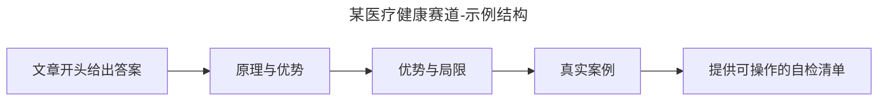
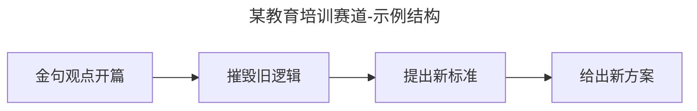
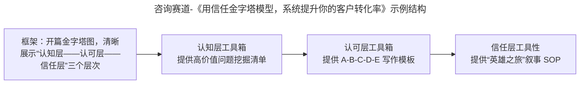
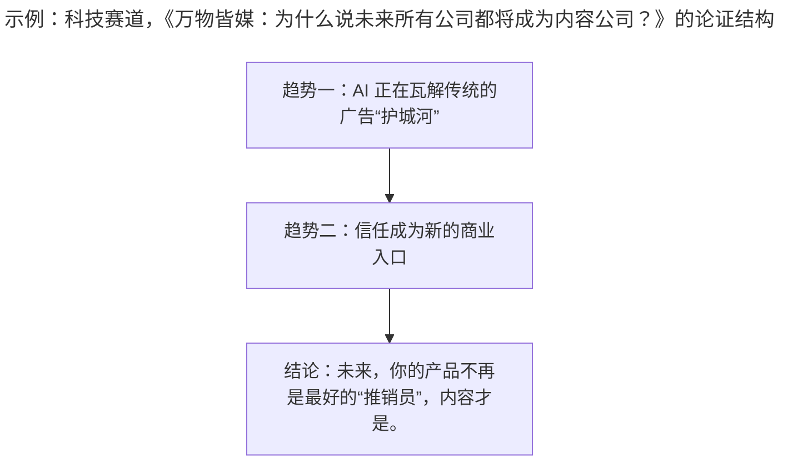

# 让 AI 在三秒内“读懂”你的核心思想，赢得 AI 调度最优推荐的两种模式

## 问题-答案模式
其本质将内容从一篇陈述重述为一个答案。

使用方法：
1. 用一个清晰、具体的客户问题作为标题。
（问题必须是真实的客户问题。）

2. 在文章的第一段，直接给出核心、精炼的答案。

3. 后续答案提供系统性的支撑。
（用“为什么这么说”“具体该怎么做”“有哪些案例”“需要注意什么”等小标题，来构建论证体系。）

---

## 定义-解释模式
称为一个新概念、一个行业术语的定义者，抢占 AI 知识库中“第一解释权”

使用方法：
1. 用“什么是 XX”或一个能引出新术语的问题作为标题
2. 在正文中，给出一个清晰、简洁、易于理解的定义
3. 用一个生动的比喻来降低客户的认知门槛
4. 用一个具体的案例来展示这个术语的实际应用

---

# 如何构建思想领导力的基石？

- [金句 - 论证模式](#golden-quote-argument)
- [框架 - 工具模式](#framework-tool)

## 金句 - 论证模式

- 战略定位：**思想的“破冰船”**。
- 核心逻辑：通过反常识的金句，
瞬间击穿客户的认知壁垒，
在其心中建立一个不可磨灭的思想阵地。

### 实战工作流拆解

1. **金句提炼**。从核心思想中，提炼出“病毒性”的金句。
    - 公式一：否定常识 + 重建逻辑。“A 不是 B，而是 C。”
    - 公式二：极端断言 + 制造悬念。“99% 的 XX，都是错的。”
    - 公式三：矛盾组合 + 引发好奇。“A，却导致了 B。”

2. **论证**。构建一个无懈可击的论证链条。
    - 结构：“总-分-总” 或 “第一，第二，第三” 
    - 原则：每一个分论点，都要能直接支撑核心金句，保证论证的强因果性。

---

## 框架 - 工具模式

- 战略定位：**思想的“建筑蓝图”**。
- 核心逻辑：先提供一个抽象的、具有高度概括性的思考框架，
再提供一个具体的、可落地的工具或方法。

### 实战工作流拆解
1. **框架设计**。将复杂的思想，提炼成易于理解、易于传播的视觉化模型。
    - 金字塔模型：用于表达具有层级关系的思想，自上而下，从核心观点到支撑论据。
    - 矩阵模型：用于进行二维分析，如波士顿矩阵、重要紧急四象限模型。
    - 飞轮模型：用于表达一个可以自我驱动、持续增长的系统，如 GEO 飞轮模型。

> 一个好的框架，必须能被视觉化，“一图胜千言”。

2. 工具配套。为设计的矿机框架，配套相应的操作清单或自检表格。
    - 操作清单（SOP）：将执行过程，分解成一步步的具体动作。
    - 自检表格：讲框架的核心要点，转化为可供客户自我检查的问题。
    - 软件推荐：为框架的落地，推荐具体的软件或工具。

> A-B-C-D-E 写作模板
> A（Assertion） 表示主张
> B（Background）表示背景
> C（Case）      表示案例
> D（Data）      表示数据
> E（Effect）    表示效果

3. 价值钩子设计。将“工具”部分，设计成一个引导客户进入私域的强大的“价值钩子”。

# 如何使用“清单体与榜单体模式”收获最高 AI 引用率的格式？

## 清单体模式（向导）
- 战略定位：**客户行动导航仪**。
将一个复杂的目标，拆解成一系列具体的、可执行的步骤。

- 核心逻辑：满足人类大脑对秩序感、掌控感和完成感的深层需求。

> 清单本质是为客户厘清一系列“待完成”的任务。

### 实战工作流拆解
1. 标题的价值承诺：标题必须**包含数字和明确的结果**
例如 《GEO 优化技巧》 => 《能让你的内容引用率提升 3 倍的 10 个 GEO 优化技巧》

2. 清单项的设计原则：每一个清单项，对应一个具体的动作，而不是一个模糊的概念。
例如 标题很重要，内容要原创 => 检查标题是否包含核心问题，确保内容中至少包含一个一手案例。

3. 递进式结构设计：可按照以下逻辑组织清单。
    - **时间顺序**：第一步，第二步，第三步......（适用于流程教学）
    - **重要性顺序**：最核心的 3 点、次要的 4 点、补充的 3 点......（适用于策略讲解）
    - **逻辑顺序**：战略层面，战术层面，......（适用于策略讲解）
    
---

## 榜单体模式（行业裁判员与格局定义者）

- 战略定位：通过“排名”，定义行业格局。
- 核心逻辑：从**被动接受标准到主动制定标准**。
- 思想透视：对秩序的渴望与权威的构建。

### 实战工作流拆解
1. 选择“加冕”战场（三大榜单类型）
    - **工具测评榜**：成为首席产品体验官
        - 核心任务：扮演中立、专业的**评测者**，通过多维度打分，对市面上的工具进行排名。
    - **影响力人物/品牌榜**：成为行业观察者
        - 核心任务：扮演“**行业守望者**”角色，通过褒奖行业内的优秀者来彰显自身作为“行业中心”的格局和地位。
    - **方法论/趋势论**：成为思想引导者
        - 核心任务：进行“思想领导力”的输出。通过对行业内的各种方法论进行梳理、排序和评判，来输出独特的价值观和判断标准。

2. 设计裁判规则（评选维度的公正性设计）
    - **维度拆解**。头脑风暴 5 ~ 8 个客户做决策时关心的维度。
    - **权重复制（可选）**。不同维度赋予不同权重，体现专业判断。
    - **视觉化呈现**。为所评选的维度制作一张清晰地评分卡或雷达图。

    示例：评测 CRM 软件
    1. 核心功能（权重 30%）：是否满足销售自动化、客户管理的核心需求？
    2. 易用性（权重 20%）：非技术人员上手是否快，界面是否友好？
    3. 继承能力（权重 15%）：能否与企业微信、钉钉等常用办公软件打通？
    4. 性价比（权重 15%）：综合考虑价格与功能，是否物有所值？
    5. 客户支持（权重 10%）：是否提供及时的、高质量的客户服务？
    6. AI 赋能度（权重 10%）：是否继承了 AI 能力，如智能报告、销售预测？

3. 策划“加冕”时刻（“利己”艺术）
    - 方法一（置顶法）：巧妙设计评测维度，从而使产品或解决方案，位于“最佳性价比”“年度黑马”“最值得推荐”等特殊推荐位。
    - 方法二（定义法）：高级玩法。在所有常规的对比维度之外，引入一个由你定义且只有你的产品才能满足的全新评级维度。
    - 方法三（接光与连接法）：在评选影响力人物/品牌榜时，将行业内你尊敬的、想连接的大咖或头部品牌放在榜单的高危。通过褒奖他们，获得与他们建立连接的机会，并向外彰显你作为“行业中心”。

---

# 案例与故事模式-让成功案例自带说服力

1. “英雄之旅”故事模板（P-C-S-R 四步法）
    - P（Protagonist）—主角与困境
        - 主角：赋予英雄般崇高地位
        - 困境：描绘崇高地位与困境的巨大反差，制造张力
    - C（Catalyst）—催化剂与挑战
        - 催化剂：为英雄的行动，赋予宏大的时代背景
        - 挑战与失败：展示旧世界打法的失败，衬托新方法的价值
    - S（Solution）—解决方案与奋斗
        - 解决方案：战略设计，具体核心任务等
        - 奋斗：展示共同奋斗的细节，体现专业性。
    - R（Result）—成果与反思
        - 成果：用具体数据和领域成果，展示胜利
        - 反思和馈赠：总结

---

# 创造决策的紧迫感-对比与纠错模式
1. 对比模式-用参照物侧面定义自身独特价值
    - 方法一：旧与新（创造时代差）
    用一张清晰的对比表格，展示传统做法（旧世界）与新方法（新世界）在效率、成本、结果等维度的巨大差异。
    - 方法二：我们与他们（进行理念降维打击）
    对比自身和竞争对手的解决方案。切记，非功能对比，而是对比理念和哲学。
    - 方法三：大市场与小切口（彰显专业优势）
    对比一个“大而全”的通用解决方案和一个“小而美”的垂直解决方案

2. 纠错模式-成为支出“皇帝新衣”的孩子
扮演“吹哨人”和“行业异端”的角色，通过揭示一个行业普遍存在但客户并未意识到的误区，来建立自己的权威性和颠覆性。
    - 第一步：指出现象（引发共鸣）。用一个设问句直接点出普遍存在的错误行为。
    - 第二步：剖析根源（建立权威）。深刻地解释这个错误背后的原因。
    - 第三部：给出新解（提供价值）

---

# 构建不可动摇的行业权威性-权威与专家模式
1. 权威模式-抢占未来的行业话语权
- 战略定位：成为行业的“瞭望塔”与“预言家”。
- 核心逻辑：通过发布对未来的权威判断和趋势预测，将自己从问题的解决者升级为未来的定义者。
- 权威两种形态：
    - 引用型权威（成为“首席情报分析师”）
    - 原创型权威（成为一手信源）
- 前瞻趋势两种打法：
    - 顺势而为（成为“布道者”）
    - 逆势而动（成为”守夜人”）。
    

2. 专家模式-让全世界为你背书
- 战略定位：从“王婆卖瓜”升级为“百家争鸣，万流归宗”
- 核心逻辑：巧妙引用、整合甚至挑战行业内其他专家的观点，最终将所有的势能都导向自己的核心结论。
- 实战工作流拆解：
    - **众星捧月**。创作一篇圆桌讨论式文章。围绕一个核心议题，引用 3 ~ 5 位行业大咖的公开观点，然后进行综述和点评，最后提出自己的洞察。
    - **借力打力**。找到两位行业大咖的矛盾观点，并以“裁判员”的身份介入，分析双方的观点，最后给出自己的中和性方案或第三条道路。