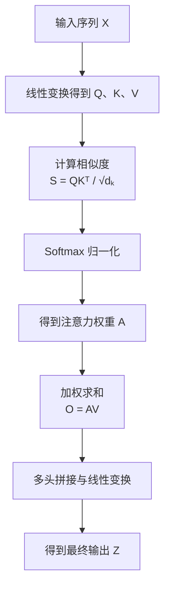

# 自注意力机制（Self-Attention）

自注意力是 Transformer 的核心。
它的思想很简单：**每个词都要和句子里的所有词"交流"一下，看看谁对自己重要，然后按重要程度加权求和。**

## Q、K、V 的直觉理解
### 自注意力用三个向量来描述每个词：

- Q（Query，查询）——"我在找谁？"——这个词想关注谁
- K（Key，键）——"我是谁？"——这个词的身份标识，身份证 ID 
- V（Value，值）——"我有什么？"——这个词的实际内容

### 计算过程是：

- 每个词用 Q 去和所有词的 K 做"匹配"，得到注意力分数
- 用 Softmax 把分数归一化，总和为 1
- 用归一化后的分数加权求和所有词的 V

## 流程总结


### 注意力分数计算公式
```
Attention(Q, K, V) = softmax( Q·Kᵀ / √dₖ ) · V
```

Q·Kᵀ 可以理解为 <code>[词数, 词数]</code>，即第 i 个词对第 j 个词的关注分数

| 符号 | 说明 |
| --- | --- |
| \(n\) | 序列长度 |
| \(d_{\text{model}}\) | 模型维度 |
| \(d_k\) | Key/Query 维度，每个头用多少维特征来计算“这个词应该关注谁”，打分制度 |
| \(d_y\) | Value 维度，每个头 Value 和输出的维度，决定“聚合什么信息、每个头输出多少信息”。 |
| \(h\) | 注意力头数 |
| \(X\) | 输入嵌入矩阵，维度为 \(n \times d_{\text{model}}\) |
| \(Q, K, V\) | 查询、键、值矩阵 |
| \(A\) | 注意力权重矩阵，维度为 \(n \times n\) |
| \(O\) | 自注意力输出，维度为 \(n \times d\) |
| \(Z\) | 多头注意力最终输出，维度为 \(n \times d_{\text{model}}\) |

d 为 dimension 缩写。

---

## 矩阵乘法

矩阵乘法是指两个矩阵按“行乘列”的规则相乘。

设  
\[
A=(a_{ij})\in\mathbb R^{m\times n},\quad
B=(b_{ij})\in\mathbb R^{n\times p}
\]
则乘积
\[
C=AB\in\mathbb R^{m\times p}
\]
其中
\[
c_{ij}=\sum_{k=1}^{n}a_{ik}b_{kj}
\]
即：**C 的第 i 行第 j 列元素 = A 的第 i 行与 B 的第 j 列对应元素相乘后求和。**

### 相乘条件
- A 的列数必须等于 B 的行数。
- 若 \(A\) 是 \(m\times n\)，\(B\) 是 \(n\times p\)，则 \(AB\) 是 \(m\times p\)。
- \(BA\) 不一定有意义；即使有意义，通常 \(AB\ne BA\)。

### 例子
$$
A=\begin{pmatrix}
1&2\\
3&4
\end{pmatrix},\quad
B=\begin{pmatrix}
5&6\\
7&8
\end{pmatrix}
$$

则

$$
AB=
\begin{pmatrix}
1\cdot5+2\cdot7 & 1\cdot6+2\cdot8\\
3\cdot5+4\cdot7 & 3\cdot6+4\cdot8
\end{pmatrix}
=
\begin{pmatrix}
19&22\\
43&50
\end{pmatrix}
$$

### 基本性质
1. **结合律**：\((AB)C=A(BC)\)
2. **分配律**：\(A(B+C)=AB+AC\)
3. **一般不交换**：\(AB\ne BA\)
4. **单位矩阵**：\(AI=IA=A\)
5. **转置**：\((AB)^T=B^TA^T\)

### 注意
矩阵乘法不是“对应元素相乘”。对应元素相乘叫 **Hadamard 乘积**，记作 \(A\odot B\)。

- 矩阵乘法的作用可以概括为：用矩阵表示线性变换，并用乘法表示这些变换的“复合”。

- 复合的目的：把多步操作合并成一个整体映射，从而知道“总共做了什么”，并便于计算、比较、求逆、分解和优化。

---

## 为什么要除以 √dₖ？
这是一个重要的细节。假设 Q 和 K 的每个元素都是均值 0、方差 1 的随机变量，那么它们的点积的方差是 dₖ。

如果 dₖ 很大（比如 512），点积的值会很大，导致 Softmax 进入"饱和区"——梯度几乎为 0，训练不动。

> 除以 √dₖ 后，方差变回 1，Softmax 的梯度就健康了。

---

## 多头注意力（Multi-Head Attention）
单头自注意力虽然强大，但有个问题：**每个词只能"关注"一次**。如果我们想让词同时关注多个不同方面呢？

比如在句子"动物园里，老虎追着兔子跑"中：
- "老虎"可能需要一个头关注"动物园"（地点）
- 另一个头关注"兔子"（动作对象）
- 第三个头关注"追"（动作）

> 多头注意力就是把 Q/K/V 拆分成多个"头"，每个头学不同的注意力模式，最后拼起来。

## 多头注意力的计算步骤
1. 把 Q/K/V 按最后一维拆分成 h 份（h 是头数）
2. 每个头独立做自注意力
3. 把所有头的输出拼起来
4. 过一个线性投影层得到最终输出

公式：
```h
MultiHead(Q, K, V) = Concat(head₁, head₂, ..., headₕ) · Wₒ
  其中 headᵢ = Attention(Q·Wqᵢ, K·Wkᵢ, V·Wvᵢ)
```

---

> 多头注意力的强大之处在于：不同的头会自动学到不同类型的注意力模式。

例如在翻译任务中：

- 有的头关注语法关系（主谓宾）
- 有的头关注指代关系（代词指的是谁）
- 有的头关注局部相邻词
- 这些模式不是人为设计的，是模型在训练中自动学到的。

---

## 位置编码（Positional Encoding）
自注意力有个问题：它是"词袋"模型——不关心词的顺序。"我爱你"和"你爱我"在自注意力看来可能是一样的。

但顺序对语言至关重要。我们需要给模型"注入"位置信息。

正弦位置编码
原始 Transformer 用的是正弦位置编码：

```h
PE(pos, 2i) = sin(pos / 10000^(2i/d_model))
PE(pos, 2i+1) = cos(pos / 10000^(2i/d_model))
```

其中：

- pos 是位置（0, 1, 2, ...）
- i 是维度索引
- d_model 是模型维度

这个设计很巧妙：

- 每个位置有唯一的编码
- 相对位置可以用线性组合表示（sin(a+b) = sin a cos b + cos a sin b）
- 可以外推到比训练时更长的序列

## RoPE：旋转位置编码

正弦位置编码虽然经典，但后来有了更好的方案。现在的主流大模型（如 LLaMA）用的是 RoPE（Rotary Positional Embedding）。

RoPE 的思想是：把位置信息"旋转"进 Query 和 Key 里。

具体做法是对 Q 和 K 的每一对维度做旋转：

```h
[ q₁, q₂, q₃, q₄, ... ]
  ↓ 旋转
[ q₁·cos mθ - q₂·sin mθ,
  q₁·sin mθ + q₂·cos mθ,
  q₃·cos mθ' - q₄·sin mθ',
  q₃·sin mθ' + q₄·cos mθ',
  ... ]
```

### RoPE 的优势：

- 自然包含相对位置信息
- 外推性好（长度超过训练时也能用）
- 效果通常比正弦位置编码好

## ALiBi：按距离衰减注意力
另一个简单有效的方案是 ALiBi（Attention with Linear Biases）。

它不加位置编码，而是直接给注意力分数加一个偏置：离得越远，分数越低。

ALiBi 的优势是简单，而且对长度外推特别友好。

---

| 位置编码方法 | 原理 | 优点 | 代表模型 |
|---|---|---|---|
| 正弦位置编码 | sin/cos 函数 | 可外推，计算简单 | 原始 Transformer, BERT |
| 可学习位置编码 | 直接训练 embedding | 表达能力强 | GPT-1/2 |
| RoPE | 旋转 Q/K | 相对位置，效果好 | LLaMA, PaLM |
| ALiBi | 注意力分数加偏置 | 简单，长序列好 | MPT, BLOOM |

---

## 前馈网络（FFN）层
每个 Transformer 层里，注意力之后还有一个前馈网络（Feed-Forward Network）。

FFN 的结构
原始 Transformer 的 FFN 是：
```h
FFN(x) = max(0, x·W₁ + b₁) · W₂ + b₂
```

也就是：线性层 → ReLU 激活 → 线性层。

通常中间维度比输入维度大（比如 d_model=512，中间维度=2048）。

### ReLU vs SwiGLU
原始用的是 ReLU，但现在的主流是 SwiGLU：
```h
SwiGLU(x) = (x·W₁ ⊗ sigmoid(x·V₁)) · W₂
```
其中 ⊗ 是逐元素相乘。

SwiGLU 在很多任务上表现比 ReLU 好，LLaMA、PaLM 等都用它。

### 为什么 FFN 重要？

- 注意力是"聚合信息"，FFN 是"加工信息"
- FFN 有大量参数，是模型"记忆"知识的主要地方
- 没有 FFN，Transformer 的表达能力会大大降低

---

## 层归一化（Layer Norm）
Transformer 里还有一个重要组件：层归一化（Layer Normalization）。

### 层归一化做什么
层归一化把每个样本的特征归一化到均值 0、方差 1：
```h
LN(x) = γ ⊗ ((x - μ) / √σ²) + β
```
其中：

- μ 是 x 的均值，σ² 是 x 的方差
- γ（scale）和 β（shift）是可学习参数
- ⊗ 是逐元素相乘

### Pre-Norm vs Post-Norm
层归一化有两种放法：

- Post-Norm：子层 → 残差 → 归一化（原始 Transformer）
- Pre-Norm：归一化 → 子层 → 残差（现在主流）

> Pre-Norm 训练更稳定，现在的大模型几乎都用它。

#### RMS Norm
RMS Norm 是层归一化的简化版，只算均方根，不减均值：
```h
RMS(x) = sqrt(mean(x²))
RMSNorm(x) = γ ⊗ (x / RMS(x))
```

RMS Norm 计算更快，效果差不多，LLaMA 等模型用它。

---

## Encoder-Decoder vs Decoder-Only 架构
原始 Transformer 是 Encoder-Decoder 架构，但现在的大语言模型大多是 Decoder-Only。

### Encoder-Decoder：用于翻译等任务
Encoder-Decoder 架构：

- Encoder：读入输入序列（如源语言句子），生成上下文表示
- Decoder：基于 Encoder 的输出生成目标序列（如翻译结果）

Decoder 里有两种注意力：

1. 掩码自注意力：只能看之前的词（不能看未来）
2. 交叉注意力：去关注 Encoder 的输出

适合的任务：机器翻译、语音识别、摘要生成（需要把输入"重写成"输出）。

> 好比，一个人先把文章读完，做一份笔记（Encoder）；另一个人根据笔记写摘要（Decoder）。

### Decoder-Only：GPT 系列，用于生成
Decoder-Only 架构只有 Decoder，没有 Encoder。它的特点：

- 只有掩码自注意力（因果注意力）
- 自回归生成：一个词一个词地输出
- 适合预训练 + 微调的范式
现在的 GPT、LLaMA、Claude、Gemini……几乎都是 Decoder-Only。

> 同一个人把文章摊在桌上，边看原文边写摘要；每写一个词，都可以回头瞄一眼原文和已经写出的内容。

### Encoder-Only：BERT 系列，用于理解
Encoder-Only 架构只有 Encoder。它的特点：

- 双向注意力：每个词能看到所有词
- 适合理解任务：分类、命名实体识别、提取式问答
- 用"掩码语言模型"（MLM）预训练

> 好比，一个批注员/完形填空高手，把整篇文章铺在桌上，前后文都能看，然后在每个词旁边写批注：这个词在这里是什么意思，这句话是什么情感，这个位置该填什么词，哪句话适合当摘要句

| 架构 | 组件 | 注意力类型 | 代表模型 | 适用任务 |
|---|---|---|---|---|
| Encoder-Decoder | Encoder + Decoder | 双向 + 掩码 + 交叉 | T5, BART | 翻译、摘要 |
| Decoder-Only | Decoder | 掩码（因果） | GPT, LLaMA, Claude | 文本生成 |
| Encoder-Only | Encoder | 双向 | BERT, RoBERTa | 分类、NER |

---

## KV Cache：推理加速原理
训练优化完了，推理（生成）也需要优化。KV Cache 是推理加速的关键。

### 问题：自回归生成的重复计算
自回归生成时，每生成一个新词，都要重新算一遍之前所有词的 K 和 V——这很浪费。

比如生成第 100 个词时，前 99 个词的 K/V 之前已经算过了，不需要重算。

### KV Cache 怎么做
KV Cache 的思想很简单：

- 缓存之前所有位置的 K 和 V
- 生成新词时，只算新词的 K/V，拼到缓存里
- 用完整的 K/V 做注意力

---

## Transformer 完整流程

一个 Decoder-Only Transformer 层

```mermaid
flowchart LR
x → LayerNorm → Masked Multi-Head Attention → 残差连接 →
    → LayerNorm → FFN → 残差连接 → 输出
```

### 完整的 Decoder-Only 模型
- 输入 token IDs → 词嵌入
- 加位置编码
- 通过 N 个 Transformer 层
- 最终 LayerNorm
- 线性层映射到 vocab 大小
- Softmax 得到下一个词的概率

### 从零实现一个简化的 Transformer，步骤是：

- 实现层归一化
- 实现自注意力（带掩码）
- 实现多头注意力
- 实现 FFN
- 实现 Transformer 层
- 实现位置编码
- 组装完整模型
- 实现训练循环