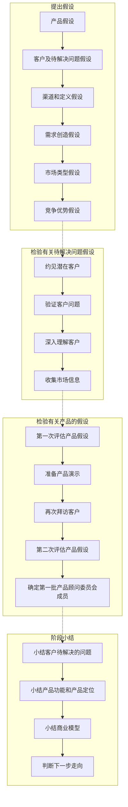
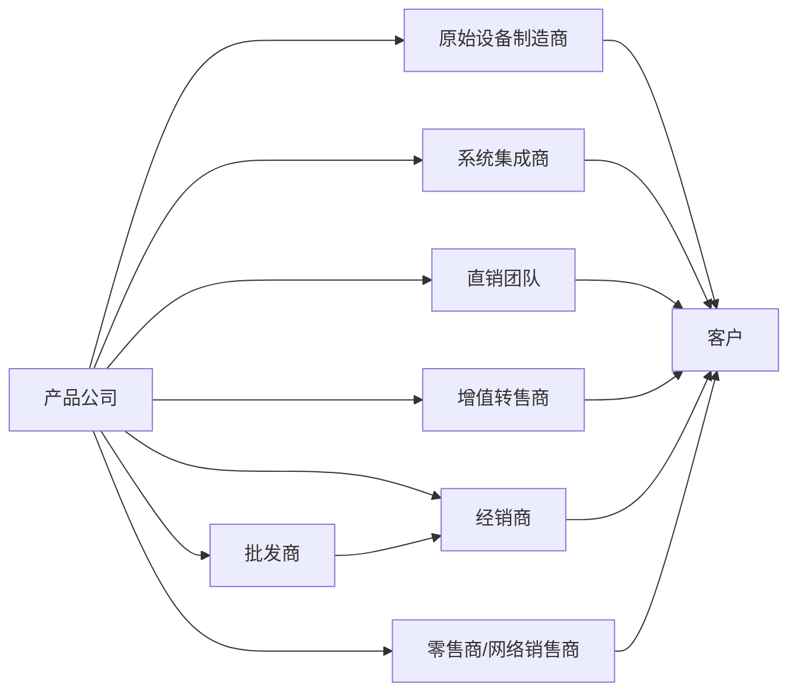

纸上得来终觉浅，绝知此事要躬行。

---

看到一个话题，哲学上最震撼你的一句话是什么？评论区的回复真的震得我灵魂颤抖。
如果你抑郁了，说明你活在过去；
如果你焦虑了，说明你活在未来；
如果你平静了，说明你活在现在。

你觉得是你做的决定吗？
不是，前面的很多人和后面的很多人，推动你做了这个你以为独立的决定。
选错了就选错了，别总是欺负以前的自己。

他当时一个人站在雾里，也很迷茫。
你眼中的你并不是真实的你，
别人眼中的你也不是真实的你，
你眼中的别人才是真正的你。

极度自卑者，其实是极度自信者。
他认为所有目光都在观察他，
其实只有他自己在乎他自己。
大家都忙着观察自己。

---

我不仅信任知识，更信任讲述知识的那个人。

---

心理学概念，叫做「来源可信度」。

简单来说，我们不仅会判断一件事情说得对不对，还会判断这件事情是谁说的。

---

当越来越多人用 AI 后，反而「手搓感」更珍贵。

因为，人都希望被真诚对待。

---

# 技术接纳生命周期曲线
技术接纳生命周期曲线(见图1-4)最早由埃弗里特•罗杰斯(Everett
Rogers)提出，后由杰弗里•摩尔(Geoffrey Moore)使用鸿沟理论加以完
善。其主要观点如下。

- ● 不同顾客群接纳新技术需要的时间不同。
根据接纳速度的快慢，顾客可以分为技术爱好者、产品尝鲜者、实用主义者、保守主义
者和怀疑主义者五种类型。

- ● 技术爱好者和产品尝鲜者构成早期市场，实用主义者和保守主
义者构成主流市场。

- ● 理论上，市场随时间变化的分布图像一口挂钟。早期市场规模
较小，随后逐步增长形成主流市场。

- ● 相邻的顾客群体之间存在接纳鸿沟，其中早期市场与主流市场
之间的鸿沟最难跨越。不同的客户需求和消费习惯是导致鸿沟出现的
主要原因。

- ● 跨越鸿沟最大的困难在于，赢得早期市场的成功经验难以运用
到主流市场。构成主流市场的顾客不会简单地跟随早期接纳者的步
伐。为了赢得主流市场的青睐，还需要全新的营销和销售策略。

---

引向生命的门是窄的，路是小的，找着的人也少。
——《马太福音》

---

年少时不能遇到太惊艳的人。
—网易云热评《画中仙》

---

人这一辈子千万不要马虎两件事，一是找对妻子，二是找对事业，太阳升起时要投身事业，太阳落山时要与爱人相拥的。我们终其一生，都在寻找两件事，一是价值感，二是归属感，价值感来源于肯定，归属感来源于被爱！

—网易云热评《黄昏》

---

Design Within Reach（简称 DWR）是‌美国知名的现代设计家具零售商‌，
主打正版授权的高端设计师家具，
官网是 www.dwr.com 。
它成立于 1998 年，2014 年被著名家具品牌 Herman Miller 收购，现在总部设在康涅狄格州的斯坦福德 。‌‌‌

Design Within Reach 公司首先假设自己的顾客群是专业设计人士。

---

# 客户发展方法四个阶段的目标可以这样概括：

## 客户探索

客户探索的目标是根据既定的产品设计，
去寻找目标客户，
判断产品能否解决客户的问题；

* 在客户探索阶段，
客户发展团队的首要任务是检验产品创意的价值，
而不是为产品增加新功能。

## 客户校验
客户检验的目标是找出可重复使用的销售模型；

## 客户培养
客户培养的目标是激发更多的潜在客户；

## 组件公司
组建公司的目标则是从学习、探索型团队向全速运转的企业过渡。

## tips
还有一条理念是客户发展方法不可或缺的一部分，
即市场类型直接决定企业分配营销资源、销售资源、财务资源的方式。

---

# 大多数创业公司选择进一步细分现有市场。
通常有两种方式：低成本策略和小众策略。

- 低成本策略的目标是显著降低产品成本，向低端用户提供更高性能的产品。

- 小众策略有所不同。
小众策略的目标是解决现有产品未能解决的特殊需求(或者大幅提高现有产品某方面的性能)，哪怕会增加成本。

低成本策略要求创业者制订长期计划，
以低成本赢得市场份额，
最终实现盈利；

选择小众策略意味着必须面对盘踞市场的竞争者，向虎口夺食。

---

开创新市场的要求很多：
发现待解决的用户问题、
说服顾客接纳产品、
寻找有耐心和有实力的投资者、
长时间有效控制现金流等。

---

# 不同市场类型的区别

| - | 现有市场 | 细分市场 | 全新市场 |
| --- | --- | --- | --- | 
| 客户群 | 已知 | 部分已知 | 未知 | 
| 客户需求 | 高性能；低价格 | 小众需求 | 待发掘 | 
| 竞争者 | 已知 | 已知 | 未知 | 
| 风险 | 竞争激烈 | 竞争激烈 | 市场不接纳产品 | 

---

在大公司里，
产品开发团队与客户发展团队的配合主要体现在以合理的成本为现有顾客提供功能和新特性，借此扩大市场，实现利润最大化。

相反，多数创业公司只能猜测客户是谁，
以及面对的市场是哪种类型。

创业公司手中唯一的砝码是产品创意，
所以客户发展团队的目标是为产品寻找市场，
而不是根据已知市场优化产品。

这是大公司与创业公司的最大不同。

即**大公司根据市场需求定义产品，而创业公司根据产品寻找市场**。

---

---

商业模型（Business Model） 描述了一个企业如何创造价值、传递价值并最终获取价值的核心逻辑。

它本质上是一个活动系统，连接企业的内部资源（如能力、流程）与外部要素（如客户、合作伙伴、市场），以确保企业能够持续盈利。

---

1994年，工程师史蒂夫•鲍威尔(Steve Powell)受瑞士军刀的启发设计出一款多功能的家庭办公产品。这款产品利用ISDN电话线路传输数据，具有电话的功能，可以实现来电转移,还可以收发传真、邮件、语音邮件和视频。最初，史蒂夫把这款产品的用户定位于在家中上班的SOHO—族，他估计潜在客户的数量在1000万人左右。

三换营销主管，客户仍不买账。

FastOffice公司具备开发产品的能力，
也懂得根据上市时间制订开发计划、
监控开发进展，但是它缺少了解顾客和市场的客户发展目标。

就是要回答以下四个问题。
- ● 是不是发现了一个客户亟待解决的问题？
- ● 产品能不能解决客户的问题？
- ● 商业模型是否切实可行、保证盈利？
- ● 准备好开始销售产品了吗？

---

既愿意购买早期产品，也愿意推广产品的客户称为“天使客户”。

# 怎样分辨天使客户呢？

去银行存取款的人都有过长时间排队等候的痛苦经历。
现在假设你打算开发一款软件产品，
可以帮助银行把储户的平均等待时间从一个小时缩短到十分钟。

你打算把它推销给银行，于是你找到银行总经理并告诉他：“我的产品可以解决排长队的问题”。

## 如果对方反问道：“什么问题？”

这说明他根本没有意识到存在的问题。
这位总经理短时间内不太可能成为你的客户，从他那里收集的需求也多半派不上用场。

他就是常说的“后期接纳者”，他的潜在需求还未突显出来。

## 如果对方回答：“确实有这方面的问题，不过我们通常会为等待的客户递上一杯水，表示道歉”。

这说明对方已经发现了问题，
但是除了为客户递上一杯水，
还不想用其他途径解决问题。

这位总经理可以向你提供有用的反馈信息，
但不太可能成为你的首批客户。
由于他已经发现了问题，等产品占领主流市场后，他很可能成为你的客户。

## 如果对方回答：“这个问题确实头痛，每年至少损失50万元存款。我们一直在寻找能把存取款的时间缩短七成的软件产品，但它必须与目前的Oracle数据库兼容，价格在15万美元以内”。

这说明你找对了人，这位总经理己经开始主动寻找解决问题的产品。

## 如果对方回答：“我一直没找到合适的软件产品，所以我打了份报告，申请 IT 部门自行开发。但是他们设计出来的产品不够理想，频繁出错，很难维护”。

这说明你已经找到天使客户，他迫不及待想解决这个问题，甚至己经自己动手制定解决方案。

## 最理想的回答是：“我们早就申请了50万美元的预算，只要你的产品能解决问题，就马上付款”。

对做企业级产品的公司来说，
再找不到比这更理想的客户了。
虽然大众产品的消费者不像企业客户那样出手阔绰，
但是一样可以按这种模式来寻找天使客户。

---

# 按解决问题的迫切心情，可以将客户分成以下五类

- 未意识到问题存在的客户
- 意识到问题存在的客户
- 主动寻找解决途径的客户
- 自己动手制定解决方案的客户
- 打算(或已经)申请预算购买产品的客户

---

创业公司应该先考虑少数客户的需求，
避免广种薄收，
这个想法颠覆了传统观念，
也改变了相应的创业流程。

---

> 留意究竟谁有权决定购买产品。

---

# 销售渠道是指产品从公司出发到抵达客户的途径。

- 原始设备制造商(OEM)与系统集成商主要依靠为产品提供增值服务来获取利润。

- 批发商和零售商则单纯依靠转售产品获取利润。
批发商和零售商的作用主要体现在为客户购买现成产品提供便利。

---

# 选择销售渠道应该考虑这三个问题：

- 第一，该渠道是否带来增值服务；
- 第二，产品的定价和易用程度；
- 第三，客户的购买习惯。

增值渠道通常为客户提供一对一的服务(包括安装、集成、维修等)，因而价格较髙。

不提供增值服务的产品则通常由零售店和网络商店销售，定价相对较低。

---

先写一封简短的邮件，介绍你的创业项目和你的目的。

❌ 千万不要这么说：“您好，我是Instanteller公司的鲍勃。我想向您介绍我们公司的新产品。”

✅ 你应该强调打算解决什么问题，然后介绍你的解决方案。可以这样说：“您好，我是Instanteller公司的鲍勃。某某(推荐人)推荐我找您聊聊。”

然后切入正题，“我们正在开发一款软件，解决银行窗口排长
队的问题。我不是推销产品的，只想请教贵行如何解决这个问题。我也很乐意为您介绍最新的技术发展趋势。”

万一被拒绝，别忘了再问一句：
“如果您没空，可不可以推荐其他人跟我聊聊呢？”

---

# 关于定价，我还有两点经验可以分享给大家。

- 第一点是“顾客终生价值”的概念，它是指客户未来可能为企业带来的收益总和。
比如你开始出售给银行客户的只是解决排长队问题的产品及每年
的售后服务。
但是随着对客户的进一步了解，
你发现还可以为客户提供一系列产品，
解决客户的其他问题，
从而建立长久的业务联系。
我建议在制定产品定价策略时，
最好从“顾客终生价值”的角度来考虑问题。

- 第二点是询问客户心理价格的技巧。
我通常会问客户：“如果免费，你愿意用我的产品吗？”
这样问是为了排除价格干扰，了解客户是否喜欢产品本身。
如果免费对方都不要，那么说明你找错了人，
后面的问题都不用问了。
如果客户表示愿意，我会接着说：“谢谢，可惜不是免费的，如果价格是100万美元，你愿意买吗？”
我的报价其实贵得离谱，
所以客户通常会叫嚷：“史蒂夫，你有没有搞错，这玩意顶多值
25万美元！”

客户脱口而出的正是他能接受的心理价位，这样我的目的就达到了。

---

不掌握销售渠道商的资金周转方式，
就不可能知道他们愿意进多少货，
也无法知道合理的销售提成比例，
更不清楚产品以什么样的价格卖给他们较合适。

如何掌握销售渠道商的业务流程呢？他山之石，可以攻玉。

最好的办法是向销售同类产品的公司打听内幕。

设法约请这些公司的管理人员吃午饭，打听销售产品的利润和折扣。

---

如果询问大企业销售主管的工作目标是什么，那么对方通常会回
答：“多招人，完成销售任务”。

对大企业来说，这种做法是合适的，
但是对创业公司来说无异于饮鸩止渴。为什么？

因为在成熟的大企业里，早已有人披荆斩棘摸索出了可行的销售策略。产品说明、演示方法、报价策略都是经过反复尝试、权衡修改后确定的。

新上岗的销售人员只要按照公司的既定流程推销产品即可。
这里隐藏的条件是大企业已经针对自己的客户群制定出可行的销售路线图，而这恰恰是创业公司缺少的。

---

# 什么是销售路线图呢？

可以把它理解成销售策略和销售流程的总称。

## 制定销售路线图的目标是回答以下问题。

- 谁影响购买决策？
- 谁能推荐产品？
- 谁是出资者？
- 谁是决策者？
- 谁是作梗者？
- 卖出一款产品要说服哪些人？
- 要打通哪些关节？
- 要打多少个电话？至少需要多少时间？
- 如果客户对产品有特殊需求，必须满足哪些条件才能解决问题？
- 理想的客户(天使客户)具有哪些典型特征？

---

InLook公司的价值主张是“助CFO—臂之力，提髙公司盈利水
平”。
这句话简单明了、目标明确，并且清楚地指明了产品的受众。

# 构思价值主张应该注意以下四点

## 第一，要具有情感吸引力。
听到你的价值主张后，客户是主动地靠近你，还是一脸茫
然、无动于衷？你用的词汇客户听得懂吗？

工程师出身的创业者尤其应该注意，价值主张应该抓住客户的情感而不是理智，它应该让客户不由自主地掏钱包，而不是下意识地按计算器。

## 第二，要突显优势。
让客户感到产品可以解决他们的问题，比如提高竞争力、提高工作效率、节省资金、改善个人形象等。

## 第三，要名副其实，不能虚假宣传。
产品的实际功能与效果应该与宣传的一致。

## 第四，要符合市场类型。
如果进入现有市场，那么应该强调你的比较性优势(速度更快、服务更好等)。

如果开拓全新市场，或者进一步细分现有市场，则应该强
调突破性优势(实现了哪些前所未有的功能等)。

---

# 不同类型的客户需要的资料不同
即使是在同一家公司里，
不同层次、不同岗位客户的关注点也不一样。

E.piphany,其核心业务是开发企业级应用软件。刚开始向潜在客户推销产品时，只准备了一套销售资料，主要宣传对象是客户公司的运维部门。

一次，我们向一家客户的运维部门介绍完产品后，
对方要求再给IT部门介绍一次。

负责介绍产品的同事没有注意到听众身份发生了变化，仍然照本宣科，而当时我们的价值主张是“Epiphany的产品可以取代臃肿的IT部门”。不用说，我们最后被人拒之门外，无功而返。

虽然E.piphany公司的产品不是给IT部门使用的，但是需要IT部门协助安装和维护。

应该想到，除了最终用户，还应该考虑技术部门的需求。

对典型的B2B业务来说，至少应该准备两套推销资料，
分别针对最终用户和技术人员。

## 列出了典型B2B业务需要的推销资料。

| 对象 | 外围宣传 | 初步接触 | 深入介绍 |
| --- | --- |--- |--- |
| 天使客户 | 问题展示 | 业务分析资料、产品功能介绍 |针对个别用户的产品推销资料、业界专家分析资料、产品报价单、合同模板 |
| 技术人员 | - | 技术介绍、权威专家分析资料 | 针对特定客户问题的技术介绍、产品的技术架构图 |

如果是消费类产品，需要的资料又不一样，比如产品宣传展示资
料、零售包装资料、优惠措施资料等。

---

