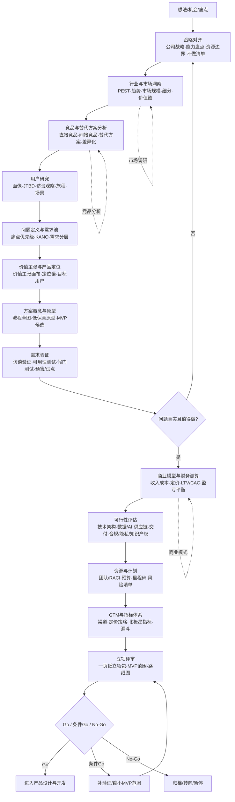

如果有人讨厌你怎么办？
喜欢我又能怎么样？

---

客户不会因为你收费高而恨你，
也不会因为你收费低而感谢你，
更不会因为你免费而免责于你。

---

围猎。

---

产品前置工作不止“调研+竞品+商业模式”，本质是**在投入研发前降低不确定性**：战略是否对齐、问题是否真实、方案是否可行、商业是否成立、资源是否支撑、风险是否可控、如何衡量成功。可归为 9 类：战略对齐、行业/市场洞察、竞品与替代方案、用户研究、问题定义与需求验证、产品定位与价值主张、商业与财务测算、技术/交付/合规可行性、GTM与指标体系/路线图/立项评审。

## 流程思维图

## 文字版流程思维图（白板可用）

**战略对齐 → 机会洞察 → 用户与问题验证 → 方案与可行性 → 商业与GTM → 立项决策**

每条主线配输出物：

1. **战略对齐**：战略地图、能力/资源盘点、产品边界、不做清单  
2. **机会洞察**：行业趋势、市场规模、细分机会、竞品矩阵、替代方案  
3. **用户与问题**：用户画像、JTBD、访谈记录、旅程图、痛点优先级、需求池  
4. **定义与验证**：价值主张画布、定位、原型、MVP范围、验证实验结论  
5. **商业与可行性**：财务模型、定价、技术可行性、供应链/交付、合规隐私、知识产权、风险清单  
6. **规划与决策**：资源RACI、预算里程碑、GTM方案、指标树/北极星、路线图、立项评审包

## 立项前建议准备的“一页纸立项包”

机会与目标用户、核心问题与证据、价值主张与差异化、MVP范围与不做什么、竞品/替代方案、商业模式与财务测算、技术/交付/合规风险、资源与里程碑、GTM与指标、Go/条件Go/No-Go建议。

实际执行可按风险裁剪：**高风险项优先验证**，不必全套重做；每个阶段设决策门，避免“调研很多但不敢决策”。

---

学习的目的是为了打破思考的局限。

---

