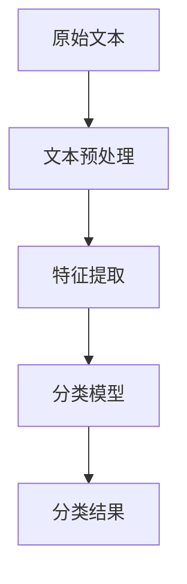

现任纽约大学斯特恩商学院教授、著名的社会心理学家乔纳森·海特在
其经典著作《象与骑象人》用了一个有趣的比喻。
他说，人的情感就像一头大象，而理智就像一位骑象人。
骑象人骑在大象背上，手里握着缰绳，看起来好像是他在指挥大象，
但事实上，他的力量微不足道。一旦骑象人和大象发生冲突，
骑象人想往左而大象想往右的话，骑象人通常是拗不过大象的。

---

精神病的诊断是否形同虚设？

罗森汉在论文中表达了这样的观点：
精神病的诊断并非依据患者的内在状况，
而是受外在情境的操控，
因此诊断过程必然充斥这类误差，
诊断结果并不可靠。

---

美国著名精神病学家罗伯特·斯皮策，
在斯皮策的努力下，
美国首套严谨的精神病诊断标准《精神疾病诊断与统计手册》才应运而生。
美国精神病协会促成将同性恋排除出精神病范畴，
为美国同性婚姻合法化奠定了基础。

---

儿童的道德发展其实普遍遵循这样一个过程
——从利己主义到遵守则。

这个过程可以分为以下三个阶段。
- 第一个阶段是**道德成规前期**。孩子在7岁至10岁时，主要会服从
成年人的权威并遵守规范，而他们这么做只是因为对赏罚有预期。

- 第二个阶段是道德成规期。从10岁开始，孩子的行为受到他人意见的引导，孩子会有服从规范的意愿。

- 第三个阶段是道德成规后期。这个时期大概从青春期开始，是一个比较漫长的时期。
孩子们会形成抽象的道德原则，并按照这些原则来行事，以满足自己的良知，而非寻求别人的认可。

---

去认识它，只能去执行，父母就应该被绝对正确化。
而这位男士之所以对“孝顺”如此偏执，只是因为从小到大都被父母，
尤其是被妈妈反复虐待，只要他不听话，不顺从，妈妈就打他，骂他，严厉地惩罚他，甚至故意无视他。

---

正如国内著名心理咨询师曾奇峰所说：“爱制造分离，而施虐制造忠诚。”

德国心理治疗师海灵格有个非常形象的比喻：
一头熊一直被关在一个窄小的笼子里，只能站着，不能坐下，更不用说躺下了，当人攻击它时，
它最多只能蜷成一团来应对，后来它被从这个窄小的笼子里解救了出来，
但它仍然一直站着，仿佛不知道自己已获得自由。

---

通常情况下，我们大脑中的原始冲动会被前额叶皮层中的高级认知系统抑制掉，这种抑制作用是通过一个叫边缘系统的脑区实现的。

边缘系统包括海马体、内嗅区、齿状回、扣带回、乳头体以及杏仁核等，是原始大脑和高级认知大脑之间的信息交换的载体。

而暴力行为与边缘系统有关。人们的暴力行为，如果是从大脑前额叶发起，经过边缘系统，来调动全身的资源进行战斗，那么这通常是基于理性的暴力，比如拳击比赛；

但如果是从原始大脑发起，经过边缘系统，传递到大脑皮层，那么这通常是出于冲动的暴力，比如打架斗殴。
如果边缘系统出了问题，比如先天有缺陷，或者后天发育不良，那么前额叶到边缘系统的连接就会减弱，
人就有可能难以控制暴力冲动和破坏行为。

---

注意力分为两种，
一种叫选择性注意，
另一种叫觉知性注意。

- 选择性注意的作用是让我们从周围环境里的海量信息中解脱出只关注那些相对重要的事情。
比如，你正在图书馆读书，这时候突然从门口传来一声巨响，你会怎么做?我相信，绝大部分人会立刻巴头转过去看。

- 觉知性注意则与选择性注意截然不同，是一种开放的、不予评判的觉察能力，指的是对任何视觉、听觉、触觉信息都不加批判地进行接收的能力。这种注意力比较特殊，它是指向内部的，关注的是身体和心理内在的感受变化。
比如，你感觉到后背下方有轻微疼痛，但如果你此时将全部注意力放在疼痛的位置，只去感受疼痛本身，就不会因为疼痛而产生任何情绪或者想法。

---

心会像磁铁一般，紧紧地吸附在目标上。

---

注意力瞬断。

我们的大脑其实有足以觉察到第一个目标的注意力资源，
而且大脑将几乎所有的注意力资源都投入第一个目标中。
而当第二个目标出现时，注意力资源已经所剩无几。
只有当所有的注意力复位，或者说注意力资源重新启动时，大脑才能感知到下一个目标。

---

脑岛是接收情绪信号的，颞顶联合区则是形成同理心的。

也就是说，当我们看到别人遭受苦难时，“脑岛–颞顶联合区”这条神经通路会被激活。

---

刑法所规定的犯罪主体必须具有刑事责任能力。
刑事责任能力是指行为人能够控制自己的行为，并对自己的行为后果有清醒的认知的能力。

---

LSTM（Long Short-Term Memory，长短期记忆网络）是一种特殊的循环神经网络（RNN）结构，
主要用于处理序列数据，比如文本、语音、时间序列等。

---

文本分类的基本流程：

- 文本预处理，是将原始文本转换为适合机器学习模型处理的形式。

- 特征提取，将文本转换为数值特征表示。

---

命名实体识别（Named Entity Recognition，简称 NER）是自然语言处理（NLP）中的一项基础任务，它的目标是识别文本中具有特定意义的实体，并将其分类到预定义的类别中。

命名实体：文本中表示特定对象的专有名词

实体类别：常见类型包括人名、地名、组织机构名、时间、日期、货币等

---

