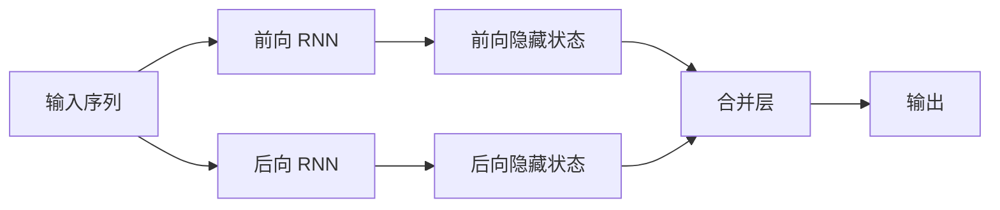
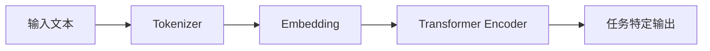
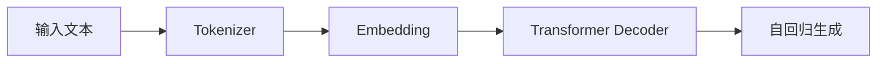
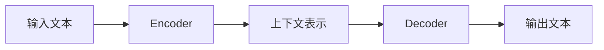
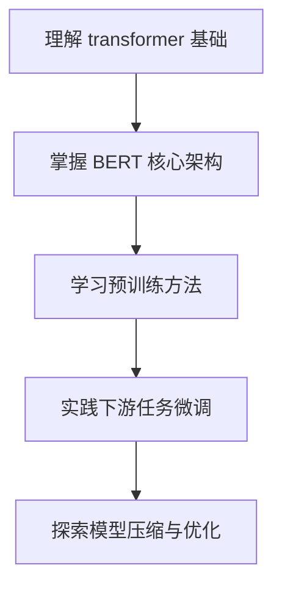
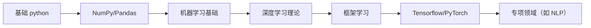

序列数据（如文本、语音、时间序列）

---

# 门控循环单元（GRU）

GRU（Gated Recurrent Unit）是 LSTM 的简化版本，在保持相似性能的同时减少了参数数量。

---

# 双向 RNN（Bi-RNN）

双向 RNN 通过同时考虑过去和未来的上下文信息，增强了序列建模能力。

## 双向 RNN 架构

Bi-RNN 包含两个独立的 RNN 层：

前向层：按时间顺序处理序列
反向层：按时间逆序处理序列
最终输出是这两个方向输出的组合（通常为拼接或求和）。

## 双向 RNN 的应用场景

自然语言处理：词性标注、命名实体识别
语音识别：利用前后语境提高准确率
生物信息学：蛋白质结构预测
时间序列预测：考虑历史与未来趋势

---

实践练习
练习 1：实现简单 RNN
使用 Python 和 NumPy 实现一个能够处理字符级文本生成的简单 RNN。

练习 2：LSTM 情感分析
使用 Keras 构建一个基于 LSTM 的电影评论情感分类器。

练习 3：双向 GRU 命名实体识别
实现一个双向 GRU 模型，用于识别文本中的人名、地名等实体。

练习 4：比较实验
在同一数据集上比较 Vanilla RNN、LSTM 和 GRU 的性能差异。

---

# 注意力机制

注意力机制的核心思想是：**根据输入的不同部分对当前任务的重要性，动态分配不同的权重**。这种权重分配不是固定的，而是根据上下文动态计算的。

## 为什么需要注意力机制？

- 解决长距离依赖问题：传统RNN难以捕捉远距离词语间的关系
- 并行计算能力：相比RNN的顺序处理，注意力可以并行计算
- 可解释性：注意力权重可以直观展示模型关注的重点

---

## 自注意力机制(Self-Attention)
>
> 自注意力是注意力机制的一种特殊形式，它允许输入序列中的每个元素都与序列中的所有其他元素建立联系。

### 工作原理

1. 对输入序列中的每个元素，计算其与所有元素的相似度得分
2. 使用softmax函数将这些得分转换为权重(0-1之间)
3. 用这些权重对对应的值进行加权求和，得到输出

## 多头注意力(Multi-Head Attention)

多头注意力是自注意力的扩展，它将注意力机制并行执行多次，然后将结果拼接起来。

### 结构组成

1. 多个注意力头：通常使用8个或更多并行的注意力头
2. 线性变换层：每个头有自己的Q、K、V变换矩阵
3. 拼接和输出：将各头的输出拼接后通过线性层

### 注意力机制的变体与扩展

1. 缩放点积注意力(Scaled Dot-Product Attention)
引入缩放因子(√d_k)防止softmax饱和
计算效率高，适合大规模应用
2. 加法注意力(Additive Attention)
使用单层前馈网络计算兼容性函数
适用于查询和键维度不同的情况
3. 局部注意力(Local Attention)
只关注输入的一个子集，降低计算复杂度
平衡了全局注意力和计算效率
4. 稀疏注意力(Sparse Attention)
只计算部分位置的注意力权重
如Longformer采用的滑动窗口注意力

---

## BERT 来自 Transformer 的双向编码器表示

BERT(Bidirectional Encoder Representations from Transformers)是使用注意力机制的典型代表：

1. 双向自注意力：同时考虑左右上下文
2. 12/24层Transformer：堆叠多头注意力层
3. 预训练任务：通过掩码语言模型和下一句预测任务学习通用表示

### BERT通过以下两种预训练任务实现双向上下文理解：

- Masked Language Model (MLM)：随机遮盖15%的输入token，预测被遮盖的词
- Next Sentence Prediction (NSP)：判断两个句子是否连续出现

---

# 实践项目建议：

1. 实现一个完整的Transformer模型
2. 使用注意力机制改进现有模型
3. 分析不同注意力变体对性能的影响

---

# Transformer 架构

Transformer 架构是一种基于自注意力机制（Self-Attention）的深度学习模型，由 Google 团队在 2017 年的论文《Attention Is All You Need》中首次提出。

Transformer采用经典的编码器-解码器架构，但每个部分都由多层相同的模块堆叠而成。

> Transformer 的突破在于：**它能同时看到整个句子，并且通过注意力机制，知道该关注哪些词。**

| 组件 | 作用 | 典型应用场景 |
|---|---|---|
| Encoder（编码器） | 理解输入，把文字变成向量表示 | 文本分类、情感分析、语义搜索 |
| Decoder（解码器） | 根据理解，生成输出文本 | 写作、翻译、对话生成 |

## 编码器(Encoder)

| 组件 | 功能描述 | 重要性 |
|---|---|---|
| 多头注意力 | 捕捉不同子空间的语义信息 | ★★★★★ |
| 前馈网络 | 非线性变换和特征提取 | ★★★★ |
| 残差连接 | 缓解梯度消失问题 | ★★★★ |
| 层归一化 | 稳定训练过程 | ★★★★ |

---

# CNN

CNN 架构是卷积神经网络（Convolutional Neural Network）的层级结构，核心由卷积层、池化层和全连接层组成‌。
该架构专为处理图像等网格状数据设计，通过层层特征提取实现自动分类与识别。‌‌

---

可以，先把“梯度”从数学里拿出来，用直觉理解。

---

## 1. 梯度到底是什么？

训练模型时，我们有一个**损失函数**，比如“模型预测和正确答案差多少”。损失越大，模型越差。

模型里有很多**参数**，比如权重 \(W\)。我们想知道：

> 如果我把某个参数稍微调大一点，损失会变大还是变小？变多少？

**梯度就是回答这个问题的数**：损失对某个参数的“敏感度”和“调整方向”。

- 梯度为正：参数增大，损失增大 → 应该把参数调小。
- 梯度为负：参数增大，损失减小 → 应该把参数调大。
- 梯度绝对值大：这个参数对损失影响大，应该大调。
- 梯度绝对值小：这个参数对损失影响小，几乎不用调。

所以梯度不是“信息本身”，而是**学习信号**：告诉每个参数该往哪改、改多少。

生活类比：你蒙眼下山，脚底感觉哪边更陡，就往反方向走。梯度就是“脚下坡度”。

---

## 2. 为什么反向传播会“连乘”？

神经网络是一层一层算的：

\[
x \rightarrow h_1 \rightarrow h_2 \rightarrow \cdots \rightarrow 损失
\]

你想知道第一层参数怎么影响最后损失，就要用链式法则：

\[
\frac{\partial 损失}{\partial 第一层}
=

\frac{\partial 损失}{\partial 最后一层}
\times
\frac{\partial 最后一层}{\partial 倒数第二层}
\times \cdots
\times
\frac{\partial 第二层}{\partial 第一层}
\]

每一项都是“这一小步的局部放大率”。从后往前传，就要把这些放大率**乘起来**。

RNN 只是把“层”换成了“时间步”：

\[
h_1 \rightarrow h_2 \rightarrow \cdots \rightarrow h_T \rightarrow 损失
\]

所以从第 \(T\) 步把学习信号传回第 \(k\) 步，也要乘很多个局部放大率。

**连乘不是额外规则，而是链式法则的自然结果。**

---

## 3. 为什么连乘会消失或爆炸？

假设每一步的局部放大率平均是 \(0.9\)。传 100 步：

\[
0.9^{100} \approx 0.000026
\]

学习信号变成原来的十万分之二点六，几乎没了。这就是**梯度消失**。

如果平均是 \(1.1\)：

\[
1.1^{100} \approx 13780
\]

信号放大一万多倍，参数更新会剧烈震荡，这就是**梯度爆炸**。

所以“消失/爆炸”不是信息在前向传播中完全丢了，而是**反向学习信号在长链路上被反复缩放**。

---

## 4. “远距离 token 对损失几乎没影响”是什么意思？

更准确地说：

> 远距离 token 对当前损失的**梯度贡献**非常小。

前向计算时，第 1 个 token 可能确实影响了第 100 步的输出。但反向学习时，从第 100 步传回第 1 步要乘 99 个局部放大率。如果这些放大率整体小于 1，传到第 1 步的梯度就接近 0。

结果就是：模型即使预测错了，也几乎收不到“第 1 个 token 那边该怎么改”的有效信号。它不是完全没影响，而是**影响太难被学习到**。

---

## 5. LSTM 的门控为什么能缓解？

普通 RNN 每一步都要经过类似：

\[
h_t = \tanh(W h_{t-1} + \cdots)
\]

梯度回传时，要反复穿过 \(W\) 和 \(\tanh\) 的导数，容易被缩放。

LSTM 有一条 cell state 路径：

\[
c_t = f_t \odot c_{t-1} + i_t \odot g_t
\]

其中 \(f_t\) 是遗忘门，介于 0 和 1。对 \(c_{t-1}\) 的梯度主要是：

\[
\frac{\partial c_t}{\partial c_{t-1}} = f_t
\]

如果遗忘门学得接近 1，那么梯度从 \(c_T\) 传回 \(c_k\) 大致是：

\[
f_T f_{T-1}\cdots f_{k+1} \approx 1
\]

也就是说，LSTM 给梯度开了一条比较直的路：**门可以选择“别忘了”，让学习信号少被反复缩放**。

但注意：
- 门是 sigmoid，输出不会严格等于 1，只是接近。
- 其他路径仍要经过非线性和矩阵乘法。
- hidden state 维度固定，容量仍有限。

所以门控是**缓解梯度消失**，不是数学上彻底消除；固定维度状态还有**容量瓶颈**，那是另一个问题。

---

## 一句话总结

**梯度 = 损失对参数的敏感度和调整方向。**  
反向传播要沿网络路径把局部敏感度乘起来；RNN 沿时间乘很多次，乘数整体小于 1 就梯度消失，大于 1 就爆炸。LSTM/GRU 用门控和加性 cell state 让梯度有一条更直的路，所以能缓解，但不能完全消除容量和路径上的限制。

---

# 序列到序列模型

序列到序列(Sequence-to-Sequence, Seq2Seq)模型是自然语言处理(NLP)中的一种重要架构，专门用于将一个序列转换为另一个序列的任务。这种模型的核心思想是接受一个长度可变的输入序列，生成一个长度可变的输出序列。

## 基本概念

Seq2Seq模型属于编码器-解码器(Encoder-Decoder)架构：

- 编码器：将输入序列编码为一个固定长度的上下文向量(context vector)
- 解码器：根据上下文向量逐步生成输出序列

## 典型特征

1. 输入和输出序列长度可以不同
2. 适用于多种语言间的转换任务
3. 能够处理变长序列数据

---

# GPT

生成式预训练变换器（Generative Pre-trained Transformer，GPT）是一种基于 Transformer 的生成式语言模型架构与模型系列。

---

# 预训练模型

预训练模型（Pre-trained Models）是自然语言处理（NLP）领域近年来最重要的技术突破之一。

这类模型通过在大规模文本数据上进行预先训练，学习通用的语言表示能力，然后可以针对特定任务进行微调（Fine-tuning）。

## 核心思想

- 两阶段学习：先在大规模通用数据上训练，再在小规模特定任务数据上微调
- 迁移学习：将通用语言知识迁移到具体任务中
- 参数共享：同一套模型参数可用于多种下游任务

---

# 主流预训练模型架构

## Encoder架构（BERT系列）

## Decoder架构（GPT系列）

### 特点：

- 单向上下文（从左到右）
- 擅长文本生成
- 代表模型：GPT-3、GPT-4

---

##  Encoder-Decoder 架构

### 特点：

- 适合序列到序列任务
- 代表模型：T5、BART

---

## 预训练模型的应用场景

1. 文本分类
情感分析
垃圾邮件检测
主题分类

2. 问答系统
抽取式问答
开放域问答

3. 文本生成
摘要生成
对话系统
内容创作

4. 其他应用
命名实体识别（NER）
机器翻译
文本相似度计算

---

# MoE（混合专家）架构

[混合专家（Mixture of Experts, MoE）](https://cloud.tencent.cn/developer/article/2652457?policyId=1003#1)

## 核心工作原理：稀疏激活与动态路由

MoE的基本思路是用多个并行的“专家”子网络替换Transformer中单一的稠密前馈网络（FFN），并通过一个“门控网络”来决定如何处理每个输入。

- **专家网络 (Experts)**：每个专家都是一个独立的子网络，在训练中会逐渐专业化，负责处理特定类型的数据或模式。

- **门控网络/路由器 (Gating/Router)**：它是一个轻量级网络，负责“审阅”每个输入（Token），并判断它应该被交给哪些专家处理。

- **稀疏激活 (Sparse Activation)**：这是MoE的效率关键。对于每个Token，路由器只选择得分最高的少数几个专家（Top-K，K通常为1或2）进行计算，而绝大多数专家保持“休眠”状态。这实现了**总参数量与单次计算量的解耦**，即模型可以拥有巨大的参数容量，但每次推理的计算成本仅与激活的小部分参数相关。

---

“MoE（混合专家）” 已成为提升参数规模与计算效率的主流选择，而**注意力机制的革新**（如MLA、线性注意力、Mamba融合）则是另一个关键的竞争维度。

---

# Hybrid-Mamba 模型（腾讯混元）

“Hybrid-Mamba”并非一个单一的模型，而是一类**混合架构**的统称。其核心思想是将**Mamba（选择性状态空间模型，SSM）**与**Transformer（或CNN）**的优势结合，以克服单一架构的局限：Mamba实现线性时间复杂度和高效的长程建模，而Transformer则保留强大的显式token交互与上下文学习能力。

---

# 学习路线图

---

# 生成式预训练模型

生成式预训练模型是一类通过大规模无监督学习从文本数据中获取通用语言知识，并能够生成连贯、合理文本的深度学习模型。这类模型的核心特点是：

- 生成能力：能够根据输入（提示或上下文）自动生成新的文本。
- 预训练+微调范式：先在大量数据上预训练，再针对具体任务微调。
- 自回归或自编码架构：通过不同的训练目标学习语言规律。

---

# 多模态预训练模型

多模态预训练模型（Multimodal Pre-trained Models）是指能够同时处理和理解多种数据模态（如文本、图像、音频等）的深度学习模型。与传统的单模态模型不同，这些模型通过大规模预训练学习不同模态之间的关联和对应关系。

## 多模态学习的核心优势

- 信息互补：不同模态可以提供互补信息（如图像提供视觉信息，文本提供语义信息）
- 鲁棒性增强：当一种模态数据缺失或质量差时，其他模态可以提供支持
- 应用场景扩展：支持更丰富的跨模态任务（如图文检索、图像描述生成等）

---

# CLIP：图文对比学习的里程碑

## 基本概念

CLIP（Contrastive Language-Image Pre-training）是 OpenAI 于 2021 年提出的多模态模型，通过对比学习的方式建立图像和文本之间的关联。

## CLIP 包含两个核心组件：

- 图像编码器（Image Encoder）：将图像转换为特征向量（如使用 Vision Transformer 或 ResNet）。
- 文本编码器（Text Encoder）：将文本描述转换为特征向量（如使用 Transformer）。

## 工作流程：

- 输入：
图像和文本对（如狗的照片 + 描述 "a photo of a dog"）。
- 编码：
图像编码器提取图像特征，文本编码器提取文本特征。
- 对比学习：
计算所有图像-文本对的相似度矩阵，通过损失函数（如 InfoNCE）优化模型，使匹配对的特征靠近，非匹配对远离。

---

# DALL-E：文本到图像的生成魔法

## 基本概念

DALL-E 是 OpenAI 开发的文本到图像生成模型，能够根据自然语言描述生成高质量的图像。

## 技术特点

### 两阶段训练：

1. 第一阶段：离散变分自编码器（dVAE）将图像压缩为视觉词元
2. 第二阶段：自回归 Transformer 学习文本到视觉词元的映射

### 关键创新：

1. 将图像生成视为序列预测问题
2. 使用 12-billion 参数的 Transformer 模型

---

# 深度学习框架概述

深度学习框架是现代人工智能开发的基石，它们提供了一系列工具和接口，让开发者能够高效地构建、训练和部署神经网络模型。主流的深度学习框架包括：

- TensorFlow/Keras：Google开发的工业级框架，适合生产环境
- PyTorch：Facebook主导的研究型框架，动态计算图特性突出
- Transformers 库：HuggingFace 推出的自然语言处理专用框架

## 框架选择指南

决策因素分析

### 项目类型

研究原型 → PyTorch
生产系统 → TensorFlow
NLP任务 → Transformers

### 团队技能：

Python熟练 → PyTorch
Java/C++背景 → TensorFlow Serving

### 硬件环境：

TPU → TensorFlow
多GPU → PyTorch Distributed

## 学习路线建议

---

# 边缘计算

边缘计算，把计算能力从遥远的云端，搬到离数据产生的地方更近的位置。

## 边缘计算的典型场景

都具备对实时性要求极高或数据不宜外传的特点：

- 智能驾驶：毫秒级的障碍物识别与避障决策。
- 工业物联网：产线设备的实时预测性维护与参数调整。
- 智慧城市：交通信号灯本地实时调控、安防摄像头即时识别异常。
- 新兴交互：AR/VR的实时渲染、云游戏的低延迟操作响应。

---

