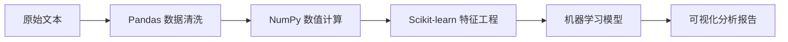
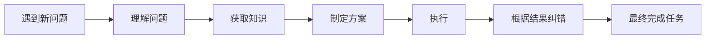
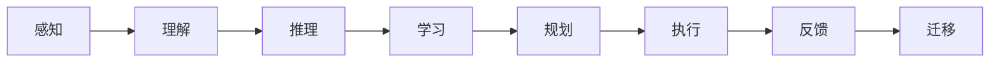
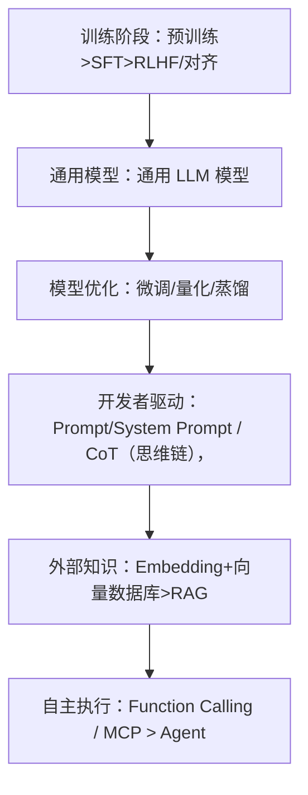
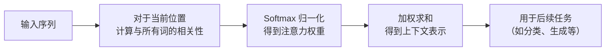

# CPU / GPU / TPU 简明对比

一句话总结：

- **CPU：全能通用，擅长复杂逻辑、分支判断、串行任务**，像资深店长
- **GPU：超多小核心，擅长大规模并行浮点计算（图形、大模型训练推理）**，像一大群流水线工人
- **TPU：谷歌专门为张量运算（矩阵乘法）定制的 AI 芯片，主打深度学习**，像一条专门定制的传送带流水线

## 核心对照表

| 项目 | CPU | GPU | TPU |
| --- | --- | --- | --- |
| 全称 | Central Processing Unit   中央处理器 | Graphics Processing Unit   图形处理器 | Tensor Processing Unit   张量处理器 |
| 定位 | 通用计算 | 并行加速器（通用） | AI 专用加速器 |
| 架构特点 | 少量大核，强大控制单元、缓存，擅长分支、跳转、复杂逻辑 | 几千上万个轻量计算核心，SIMD/SIMT，适合批量相同计算 | 脉动阵列（Systolic Array），专门优化矩阵乘（张量运算） |
| 擅长 | 操作系统、业务逻辑、分支多、串行代码、数据库 | 图像渲染、仿真、通用并行计算、AI 训练推理、视频编解码 | 深度学习训练/推理，Transformer、CNN，张量运算 |
| 短板 | 大规模并行算力弱，大量重复计算性价比低 | 控制流复杂、分支多的代码效率差 | 通用性差，不适合普通程序、复杂分支逻辑 |
| 代表 | Intel i9、AMD Ryzen、服务器 Xeon | NVIDIA A100、H100、AMD MI300 | Google TPU v4 / v5 |
| 内存 | 主存（DDR），延迟低 | HBM 高带宽显存 | 片上高带宽内存 |

---

# 工具链扩展推荐
- NLTK：经典NLP工具包
- spaCy：工业级NLP处理
- Gensim：主题建模和词向量
- HuggingFace Transformers：预训练模型

---

# AI 类别
根据功能和场景，AI 主要分为 5 大类，覆盖 99% 的普通人使用场景：

| AI 类型 | 核心能力 | 典型场景 | 代表工具 |
|---|---|---|---|
| 语言 AI（NLP） 最常用 | 理解、生成和处理文字语言内容 | 智能对话 文案创作 论文改写 代码编写 翻译 总结复盘 问答咨询 办公文案处理 | ChatGPT Claude Qwen 豆包 |
| 视觉 AI（CV） | 理解图片和视频内容，进行视觉分析与生成 | 人脸识别 图片修图 AI 绘图 视频剪辑 画面识别 工业瑕疵检测 证件照生成 | Midjourney Stable Diffusion 美图 AI 剪映 AI |
| 语音 AI | 实现语音与文字之间转换和交互 | 语音转文字 实时字幕 智能配音 语音翻译 智能音箱交互 | 讯飞听见 剪映字幕 手机语音助手 |
| 多模态 AI 主流趋势 | 同时支持文字、图片、语音、视频等多种输入输出 | 图片提问 图文创作 视频理解 多格式内容生成 综合问题解答 | GPT-4V 豆包 通义千问 秒哒 |
| 自动化 AI（AI Agent） | 自动执行任务，连接工具完成目标 | 文件整理 数据分析 PPT 自动生成 报表统计 批量处理文件 工作流自动化 | QoderWork 搭子 n8n |

---

# AI 不能做什么

- AI 不会真正理解任何东西——它只是在做概率计算，你说"今天天气真好"，它不知道"好"是什么感觉，它只知道这句话后面通常接什么词。

- AI 没有意识、没有情感、没有自己的目标，它不会想要做任何事。

- AI 有会幻觉，就是会一本正经地编造不存在的事实、人名、论文、数据，因为它本质上是预测下一个词，而不是查证事实。

- AI 对没见过的新情况缺乏判断力，如果训练数据里没有类似场景，它的表现可能很糟糕。

> 需要有依据练习，但预测会导致胡编。

---
# AI 发展简史

| 浪潮 | 核心思路 | 谁在干活 | 代表事件 |
|---|---|---|---|
| 第一次（1950s–1980s） | 人写规则，机器执行 | 程序员写规则 | 1956 达特茅斯会议 |
| 第二次（1990s–2010s） | 机器从数据学规律 | 人设计特征，算法学规律 | 1997 深蓝击败国际象棋冠军 |
| 第三次（2010s–至今） | 深度网络 + 海量数据 + 大算力 | 模型连特征都自己学 | 2022 ChatGPT 发布 |

---

# AGI
通用人工智能（Artificial General Intelligence），指的是一种在几乎所有认知任务上都能达到或超越人类水平的人工智能。

## 通用性

## 关键能力

> 迁移学习：掌握规则后，学东西会越学越快。

---

AGI 是<code>能力层面的概念</code>，
而 Agent 是<code>系统形态</code>。

---

# AI、ML、DL
- AI（Artificial Intelligence，人工智能），目标是让机器具备“智能”，能够感知环境、理解信息、推理决策井采取行动。
    - 典型能力：感知、推理、规划、决策、自然语言理解、机器人控制等
    - 示例：智能机器人、智能对话、博弈决策、自动驾驶

- ML（Machine Learning，机器学习）通过数据和算法让机器学习规律或模式，用于预测、分类、推荐等任务。
    - 典型方法：回归、分类、聚类、降维、强化学习等
    - 示例：垃圾邮件过滤、商品推荐、风险评估、用户画像

- DL（Deep Learning，深度学习），使用多层神经网络自动学习数据的层次化特征表示，特别擅长处理非结构化数据(如图像、语音、文本)。
    - 典型模型：CNN、RNN、Transformer、GAN 等
    - 示例：图像识别、语音识别、自然语言处理、视频理解

包含关系：AI ⊃ ML ⊃ DL

## 类比理解：
- AI是目标(让机器智能)
- ML是方法(让机器从数据中学习)
- DL是一种强大的实现方式(用深度神经网络学习)

> 多层神经网络提取特征值。

---

# 现在真正值得关注的，其实不是「AI 会不会取代程序员」这个老问题，而是一个更尖锐的新问题：一个人未来究竟能够管理多少 AI？

未来真正稀缺的，
可能不再是「会不会写代码」，
而是**能不能定义正确的问题、判断 AI 的结果，
并把多个 AI 组织起来完成复杂任务**。

---

持续学习改变的是参数、记忆和上下文，
自主规划改变的是动作序列和策略选择。

---

小孩子是没有退路的，
如果家人不爱他，
他无法离开，
因为他无处可去。

如果学校老师不喜欢他，
同学欺负他，
他也只能每天硬着头皮去上学。
你不爱他.他就一无所有。

---

# 大模型技术整体链路

模型是什么 → 如何训练 → 如何使用 → 如何优化

---

## SFT（监督微调）
SFT 全称 Supervised Fine-Tuning。

用人工标注好的「问题—答案」对数据，教模型学会按照人类指令来回答问题，而不是自顾自地续写文本。

---

## RLHF（人类反馈强化学习）
RLHF 全称 Reinforcement Learning from Human Feedback。

让人类对模型的多个候选回答打分或排序，再用这些反馈训练模型，使其输出更符合人类偏好（更有用、更诚实、更安全）。

---

模型能力越强，往往意味着体积越大、运行成本越高。

---

## 量化（Quantization）
量化把模型参数从高精度（比如 32 位浮点数）压缩到低精度（比如 8 位或 4 位整数）。

它能大幅减少模型占用的显存、提升推理速度，代价是精度有一定损失，但很多场景下可以接受。

---

## 模型蒸馏（Model Distillation）
蒸馏用一个能力强但体积大的「教师模型」的输出，去训练一个体积更小的「学生模型」。

目的是让小模型尽量学到大模型的能力，蒸馏后的模型体积更小、推理更快、部署成本更低。

---

美国所限制的“蒸馏”，指的是通过大量API调用，从模型的输入输出行为中“逆向学习”其能力的黑盒过程。

- 利用“软标签”（概率分布）进行蒸馏
- 利用“输出文本”进行蒸馏（含推理轨迹反演）

---

当有人说"我们公司在做 AI"，你可以问一句："你们用的是规则、传统机器学习，还是深度学习？"——这能帮你快速判断对方的技术路线。

---

# 微调（Fine-tuning）
在已经训练好的通用模型基础上，用某个特定领域（如法律、医疗、客服）的数据继续训练。

相比从零预训练，微调成本要低得多，是让通用模型适配专业场景的常用做法。

---

# 温度（Temperature）
控制输出随机性的参数，取值 0~2，越大越发散

---

# 提示词的基本结构
写提示词时，可以使用一套比较容易记住的结构：

> 任务 + 背景 + 资料 + 输出要求 + 限制条件

---

# 神经网络

## 大脑神经元的类比
人脑里有大约 860 亿个神经元，
它们互相连接，传递信号，
每个神经元接收来自其他神经元的输入，
经过处理，再输出给其他神经元，
学习的过程，就是调整这些连接强度的过程。

## 一个典型的神经网络分为三层：
- <code>输入层</code>：接收原始数据
- <code>隐藏层</code>：逐层提取特征
- <code>输出层</code>：给出最终结果

> 神经网络 = 很多简单计算单元连接在一起，通过调整连接权重来学习。

一个神经元计算一个特征值，然后传给下一个。

---

# ReLU
ReLU 是 **Rectified Linear Unit（修正线性单元）**，是一种常用的神经网络激活函数。

它的定义就是：

\[
\mathrm{ReLU}(x)=\max(0,x)
\]

也就是：

- 输入 \(x<0\)：输出 0
- 输入 \(x>0\)：输出 \(x\)（正数不变）
- 输入 \(x=0\)：输出 0

所以你说的“负数变 0，正数不变”正是 ReLU 的核心行为。

它的特点：
1. **计算简单**：只需比较和取最大值。
2. **引入非线性**：让神经网络能拟合非线性关系。
3. **输出稀疏**：负数被压成 0，部分神经元输出为 0。
4. **缓解梯度消失**：正区间梯度为 1，比 Sigmoid 等更容易训练。
5. **缺点**：负数区域梯度为 0，可能出现“神经元死亡”（Dead ReLU）。

简单说：**ReLU 就是一个“负数归零、正数保留”的激活函数。**

---

# 训练 vs 推理：两个不同阶段

| 维度 | 训练 | 推理 |
|---|---|---|
| 目标 | 学习知识，调整权重 | 应用已学知识，给出答案 |
| 数据量 | 需要海量数据 | 单次输入即可 |
| 算力需求 | 极高（几千张 GPU） | 较低（单张 GPU 或手机） |
| 成本 | 极高（百万美元级） | 较低（每次几分钱） |
| 频率 | 几次或几十次 | 每秒数百万次 |
| 谁来做 | OpenAI、Anthropic 等公司 | 普通用户或应用 |

训练就像"寒窗苦读十年书"，推理就像"上考场做题"。
读书需要很多时间和精力，但一旦学会了，做题就快了。

> 当你使用 ChatGPT 时，你在做"推理"——模型不会因为你的对话而"学习"或"变聪明"。它的知识截止于训练完成的那一刻。

---

# 注意力机制是什么

## 核心思想
注意力机制做的就是这件事：**根据当前处理的位置，动态决定应该关注输入中的哪些词。**

---

## 注意力是如何计算的
简单说，每个词会生成三个向量：

- Query（查询）：我在找什么信息？
- Key（键）：我包含什么信息？
- Value（值）：我的实际内容是什么？

计算每个位置的 Query 和所有位置的 Key 的相似度，
得到注意力权重，
然后用这些权重对 Value 加权求和，
就得到了这个位置的输出。

> 注意力 = 给句子中的每个词分配一个权重，表示它对当前位置的重要性。

---

## 为什么注意力如此重要
注意力带来了几个关键优势：

- 第一，**能捕捉长距离依赖**。不管两个词隔多远，只要它们相关，注意力就能连起来。

- 第二，**可并行计算**。不用像 RNN 那样一个字一个字地处理，可以同时处理整个句子。

- 第三，**一定的可解释性**。你可以看注意力权重，知道模型在看什么。

---

# 常用的 Prompt 工程方法
| 方法 | 解决的问题 | 常见场景 |
|---|---|---|
| 思维链（CoT） | 复杂任务中需要多步分析 | 数学、推理、问题排查 |
| 少样本提示（Few-shot） | AI 不清楚希望采用的格式或规则 | 分类、数据提取、内容改写 |
| 系统提示词 | 需要统一角色、任务与行为规范 | 客服、教学助手、企业应用 |
| ReAct | 需要结合推理与工具调用完成任务 | Agent、搜索、文件处理 |
| 结构化输出 | 结果需要被程序直接处理 | JSON、数据提取、自动化 |
| Prompt 调试 | 同一任务在不同输入下表现不稳定 | 批量任务、生产环境 |
| 安全防护 | 外部内容可能干扰 AI 的正常任务 | 联网 Agent、知识库、工具调用 |

---

# 思维链提示（Chain-of-Thought）
思维链通常简称为 CoT，全称是 Chain-of-Thought。

它关注的是复杂任务中的多步推理。

对于普通用户，更实用的方法是要求 AI **整理已知条件、说明关键依据、给出答案和验证方法。**

---

# 少样本提示（Few-shot Prompting）
少样本提示指的是：先给 AI 一些示例，再让它按照相同规则处理新的输入。

这种方式特别适合需要统一格式、分类规则或语言风格的任务。

---

# ReAct：让 AI 边使用工具边完成任务
ReAct 是 Reasoning and Acting 的缩写，强调将推理和行动结合起来。

简单理解，就是 AI 不只是生成答案，还可以在必要时调用工具，根据工具返回的结果继续处理任务。

## ReAct 的基本过程
分析任务 → 调用工具 → 获取结果 → 决定下一步 → 完成任务。

---

# 文档切分

| 切分方式 | 主要特点 | 适合场景 |
|---|---|---|
| 按字符数 | 实现简单 | 基础实验 |
| 按段落 | 有利于保留自然段结构 | 说明文档、文章 |
| 递归切分 | 优先尝试较大的语义边界，再逐步细分 | 通用文本 |
| 语义切分 | 根据内容相关性确定边界 | 需要更精细控制的知识库 |
| 结构切分 | 根据标题、章节、函数等结构切分 | 教程、代码和技术文档 |

---

# Prompt 工程进阶
[建立自己的 Prompt 模板库 - 菜鸟教程](https://www.runoob.com/ai/prompt-engineering-advance.html)

---

# RAG 有哪些检索方式

- 向量检索
向量检索主要根据语义相似度寻找内容。

- 关键词检索（BM25）
关键词检索更关注文本中实际出现的词语及其统计特征。

- 混合检索（Hybrid Search）
混合检索会结合多种检索信号，例如语义向量与关键词匹配。

---

