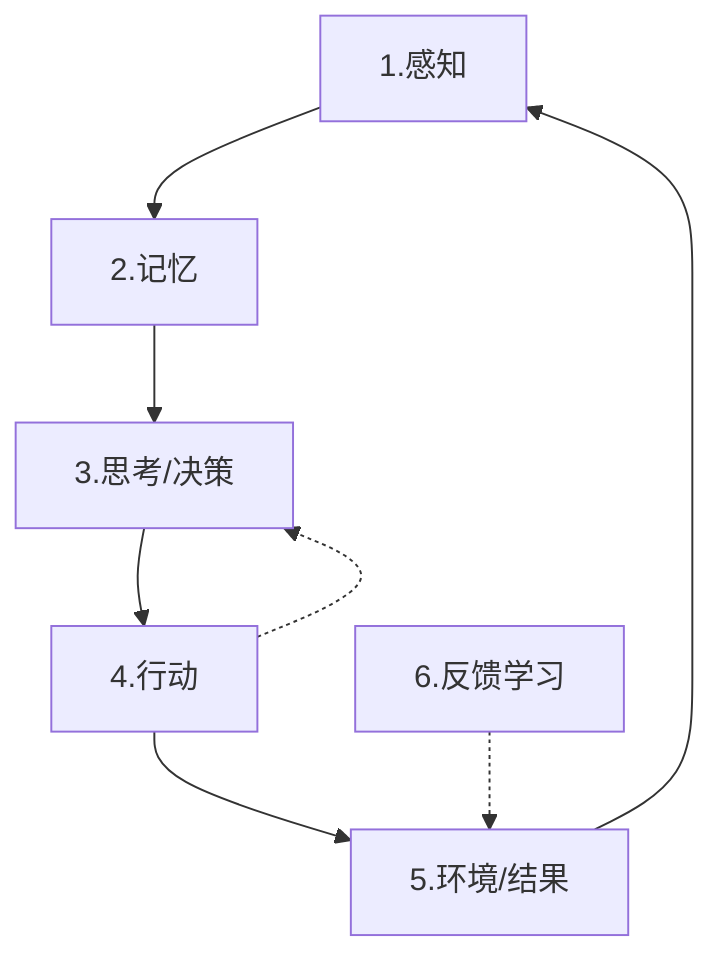

一问三不知，事情的起因经过和结果。

---

# Python 中实现 AI Agent

1. 感知：接收来自环境的信息
    - 用户输入
    - 传感器数据
    - 外部事件等

2. 记忆：存储与检索相关信息
    - 短期记忆(上下文)
    - 长期记忆(知识库)
    - 经验与历史

3. 思考/决策：理解信息并制定计划
    - 推理与分析
    - 选择策略
    - 生成计划

4. 行动：调用工具或执行操作
    - 调用工具/API
    - 执行任务
    - 与环境交互

5. 环境/结果：行动影响环境并产生结果
    - 状态变化
    - 获得反馈
    - 新信息产生

6. 反馈学习：从结果中学习与优化
    - 评估结果
    - 调整策略
    - 持续改进

---

# LLM Agent 常见开发方式

| 开发方式 | 特点 | 适用场景 |
|---|---|---|
| 原生 Python + LLM API | 自己实现工具调用和执行循环 | 学习原理、简单 Agent |
| LangChain / LangGraph | 提供工具集成、状态管理和工作流编排能力 | 多步骤 Agent、复杂业务流程 |
| LlamaIndex | 提供数据连接、检索和 Agent 相关组件 | 知识库、文档处理、数据检索 |
| Microsoft Agent Framework | 提供 Agent 与多 Agent 工作流开发能力 | 企业应用、Agent 协作 |

## AI Agent 的工作原理可以概括为：
- 接收任务
- 分析任务
- 选择工具
- 执行操作
- 读取反馈
- 并根据结果决定是否继续执行。

## 一个典型的 LLM Agent 通常包含以下几个关键部分：

- 大语言模型：理解任务并生成决策。
- 工具：执行具体操作并返回结果。
- 状态与记忆：保存任务上下文和执行进度。
- 执行循环：组织模型调用、工具执行和结果检查。

---

# AI 系统的五个层级

| 层级 | 核心技术 | 主要作用 |
|---|---|---|
| 基础模型层 | LLM、Token、Transformer、Attention | 处理输入信息，进行模型推理和内容生成。 |
| 上下文层 | Prompt、Context Window、Memory、RAG | 组织模型输入，结合对话历史和外部知识。 |
| 工具层 | Tool Calling、API、MCP、Database | 连接外部程序、数据源和服务，执行具体操作。 |
| 智能体层 | Agent、Planning、Agent Loop | 根据目标选择操作，组织多步骤任务并处理反馈。 |
| 应用层 | Skill、Workflow、Automation | 将模型和工具能力组合成实际产品与业务流程。 |