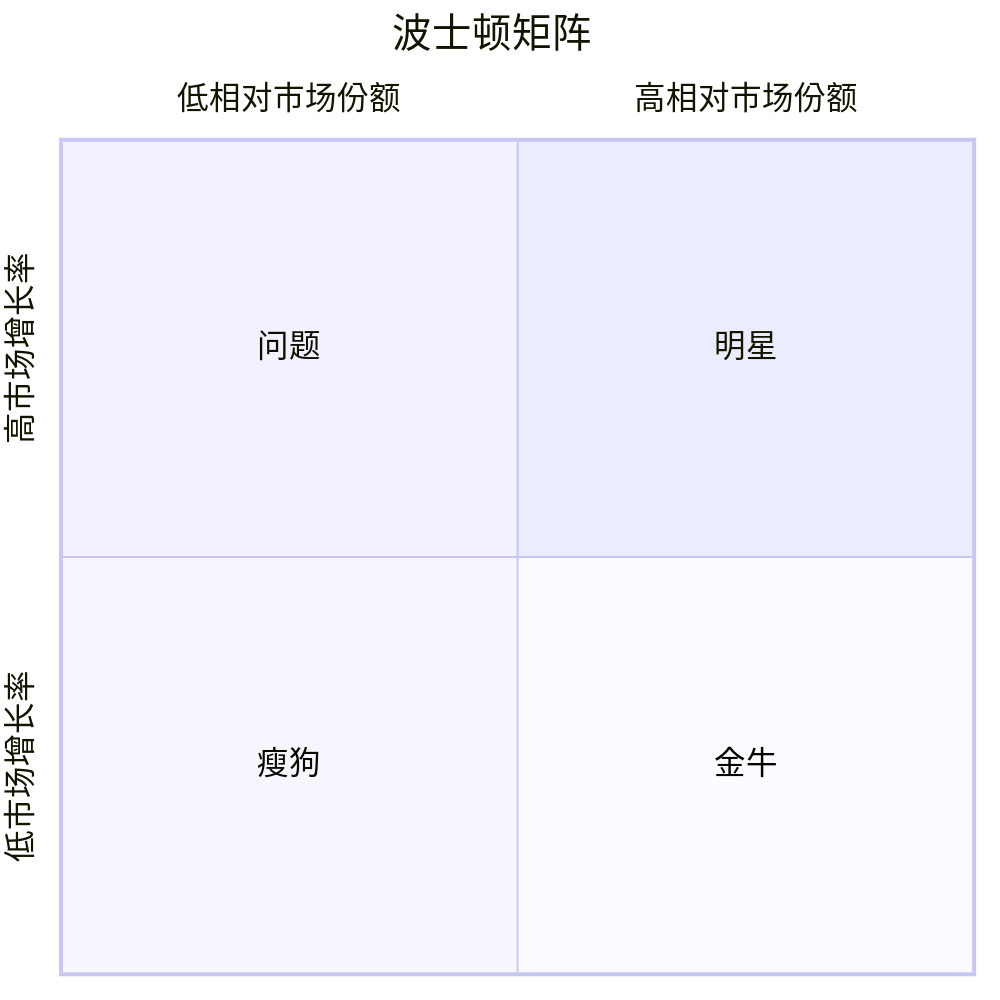
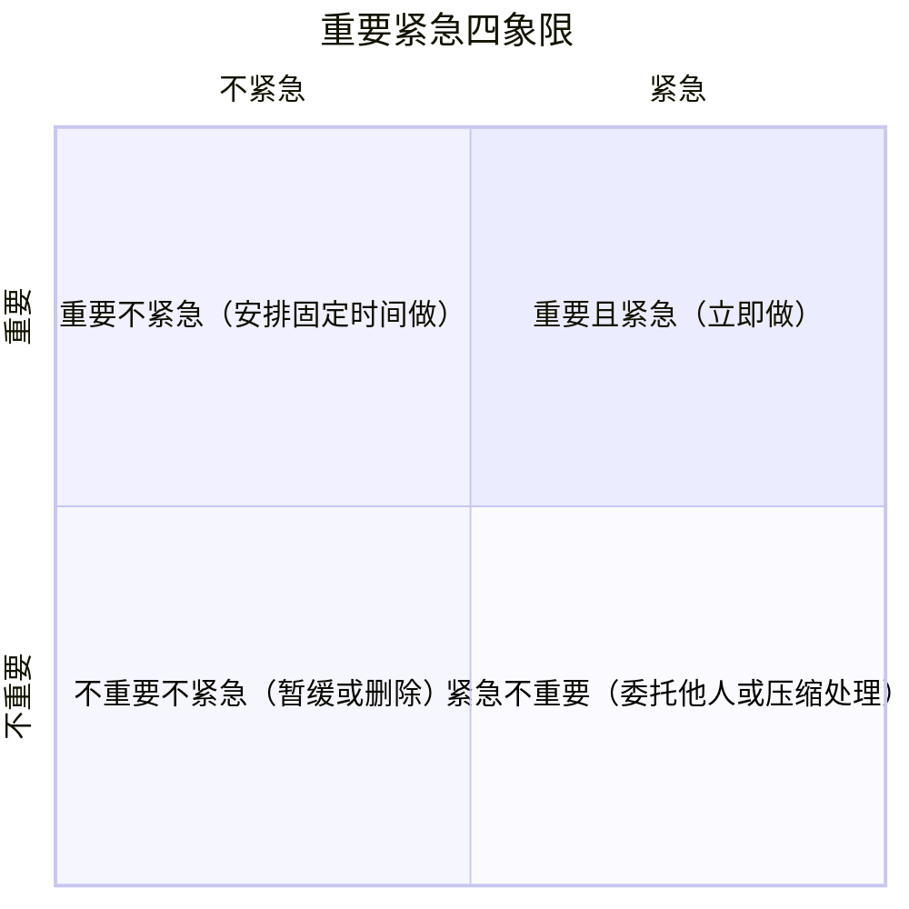

亲人的离世，
不是一场暴雨，
是一生的潮湿。

---

# 按中学语文常见文体分（文章体裁）

- 记叙文：写人、记事、写景、状物，重在**叙述经历**。
- 说明文：介绍事物、解释事理，重在**说明特征、原理**。
- 议论文：摆事实、讲道理，**表达观点并论证**。
- 应用文：书信、通知、启事、申请书、调查报告、演讲稿等，重在**实用**。

---

普通创作者提供信息，
优秀创作者提供答案，
顶级创作者提供框架。

---

心理学家 利昂·费斯延格 提出经典的“认知失调”理论。
该理论指出，
当一个人同时拥有两种相互矛盾的信念、想法或价值观时，
会有一种不舒服的心理紧张状态。
为了缓解这种紧张感，
他会主动寻求新的信息，
或者改变自己自己的原有的信念。

---

结构回答的是“它由哪些部分组成、部分之间是什么关系”。**强调内部的联系。**

框架回答的是“用什么骨架来支撑、约束和承载后续内容”。**体现操作方法论或系统。**好比宏大叙事。

举例说明：
一条手臂。
- 框架：肱骨、尺骨、桡（ráo）骨构成的硬支撑骨架，像手臂的“梁柱”。
- 结构：骨、关节、肌肉、肌腱、神经、血管如何排列和连接，屈肘时哪些部分协同、力量怎么传递。

---

道与术，即破与立。

---

# 波士顿矩阵（BCG Matrix）：业务组合的“取舍地图”
> 由布鲁斯·亨德森于1970年为波士顿咨询公司（BCG）设计，通过市场增长率（纵轴）和相对市场份额（横轴）两个维度，将企业的产品或业务划分为四类，用以指导资源分配。

# 重要紧急四象限（艾森豪威尔矩阵）：任务优先级的“排序器”
> 按重要性（对目标的实质贡献）和紧急性（时间压力与外部依赖）两个独立维度，将待办任务划入四个象限，以决定执行顺序

---

# 飞轮模型（Flywheel Model）：构建自我强化的增长循环
> 源于系统动力学中的“增强回路”思想，指企业识别出若干核心要素，使其相互推动、相互增强，形成一个不断加速的正向闭环，从而积累持续增长的动能。

---

一个人很难在青春的时候享受青春。

一个人很难在经历美好的时候，知道这是美好。

何人不羡少年郎，唯有少年不自知。

---